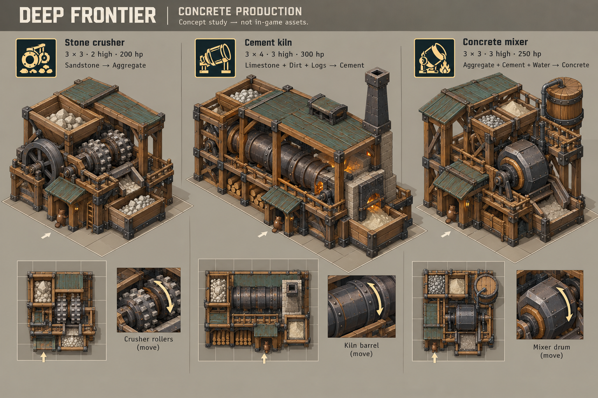
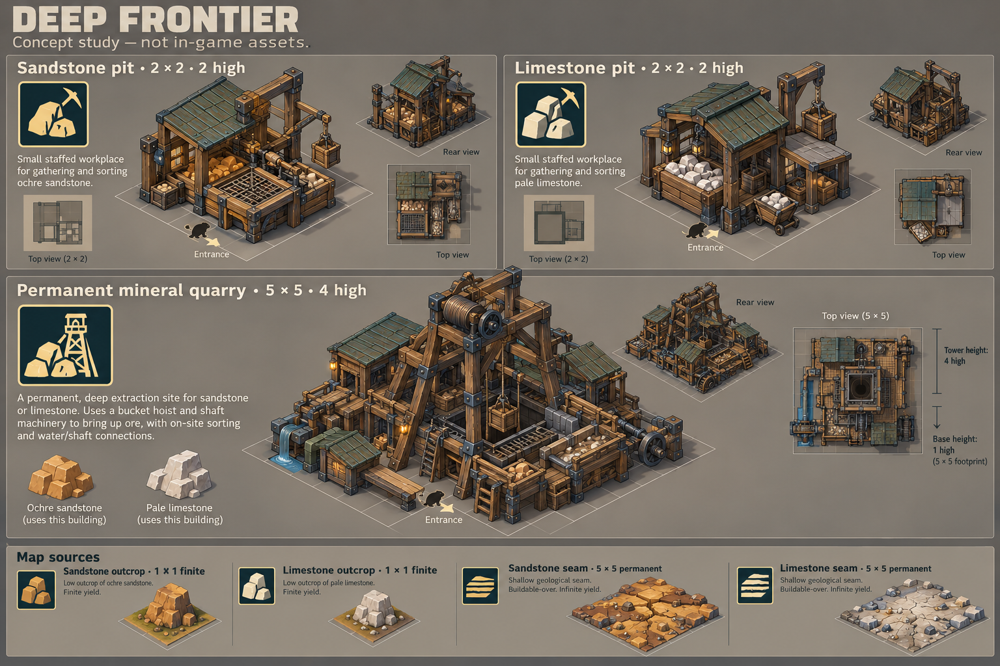
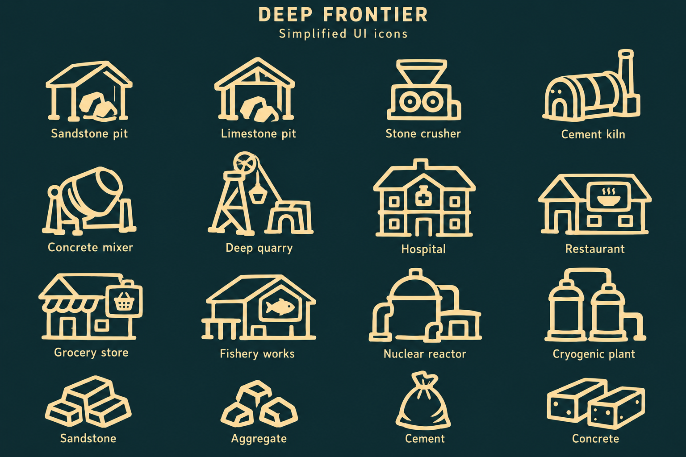

# Approved visual references

The user approved these concept sheets on 2026-10-18 and requested actual models with comparable or greater detail. These images are the design references, not merely mood boards. Match their silhouette, arrangement, architectural masses, material treatment and distinctive machinery. Change blueprint dimensions and collision/access data together when necessary to fit the design at beaver scale; do not shrink the design to preserve an arbitrary old size.

## Revised scale targets — 2026-10-18

**2026-10-19 update:** the crusher rebuild is visually accepted as good enough. For the kiln and every future building, use **only the isometric concept illustration**. Top-down views must not influence the models; ignore them along with all printed tile counts. Historical top renders remain archival only. Infer hidden architecture consistently from the isometric building and review with angled 3D renders.

**Latest direction supersedes every tile count, including labels printed on the images:** build ALL reference buildings as standalone Blender assets first. Match silhouette, proportions, layout, architectural detail and materials. Determine the game tile envelope only after the models look right, then update occupancy, collision, access and the workbook together. The table is retained as prior discussion, not a constraint. The second, tall crusher draft was also rejected; it is not the quality baseline for the remaining models.

The user corrected the dimensions after comparing the first Blender draft with the concepts. These values supersede the printed labels in the original images. Sizes are width × depth × height in game tiles. Targets are not claims that all meshes and runtime blueprints have already been rebuilt.

| Building | Working target | User direction / footprint detail |
| --- | --- | --- |
| Stone crusher | 3 × 3 × 4 | User expects 3–5 high; author four levels around the hopper and exposed machinery. |
| Both permanent quarries | 10 × 10 × 8 | At least eight high; remove a few blocks at one or two corners. Working layout uses two 2 × 2 corner cutouts, with actual occupancy and collision matching. |
| Hospital | 6 × 6 × 4 | Approximately 6 × 6 and 3–5 high; distinct wings and entrance. |
| Restaurant | 5 × 5 × 4 | 5 × 5 and 3–4 high. |
| Grocery store | 5 × 5 × 4 | Same overall scale as restaurant; distinct storefront and loading area. |
| Fishery works | 5 × 5; height under art review | User specified footprint only. Size height around the roof and water equipment. |

Maintain beaver-scale doors, railings, stairs, furnishings and texture density. Recompose the architecture at these dimensions; do not uniformly enlarge a small model. The existing five-tile geological seam and native understructure constraint require inspection before the larger quarry is considered placement-ready.

## Concrete production

**Current Blender review:** [crusher and kiln facades, doors and height layers](reviews/2026-10-19-factory-detail-pass/README.md). Both follow the user's explicit doorway-at-0, porch-roof-at-1, walking-deck-at-2 arrangement, with railings above the walking surface. Earlier links below preserve the accepted designs before this additional direction. Native game integration is still pending.

**Further direction, 2026-10-19:** the user accepted the worn crusher, then requested the quarry. During quarry review they expanded the requirement to all buildings: show coherent material flow between machines (internal belts/chutes can be animated visual geometry), enclosed building sections, and more advanced exterior pipes/instrumentation as technology increases. They then explicitly clarified **no visible interiors**: use native-style arched dark doorways and opaque windows. Do not make cutaways or furnished interiors. Beavers should appear at the doorway while idle through native worker-slot behavior; do not add beaver meshes. Preserve the accepted crusher/kiln silhouettes while applying this further detail pass.

The subsequent height requirement makes functional floor elevations whole game layers at the source. See [height layout](height-layout.md). The crusher/kiln now use layer 2 work decks with rebuilt lower supports and stairs; detailed machinery is rigidly mounted above them. Quarry galleries use layers 1, 3, 5 and 7. No printed concept tile count or top view is used to choose these elevations. Earlier dated renders preserve the prior art reviews; current height-aligned renders belong to the new review set.

**Prior accepted review:** the kiln is approved by the user. The crusher subsequently received the same worn workshop treatment, with wider decks, stairs, separate rails and additional mechanical fittings. Blender renders: [front](reviews/2026-10-19-crusher-workshop/StoneCrusher-front.png), [front right](reviews/2026-10-19-crusher-workshop/StoneCrusher-front-right.png), [back left](reviews/2026-10-19-crusher-workshop/StoneCrusher-back-left.png), [detail](reviews/2026-10-19-crusher-workshop/StoneCrusher-detail.png), and [motion](reviews/2026-10-19-crusher-workshop/StoneCrusher-motion.mp4). The prior crusher links below record its earlier review. The user accepted this worn crusher before requesting the quarry. The subsequent closed-facade detail pass is a new review; game integration remains separate.

Stone crusher: exposed paired rollers; large left-hand feed hopper; a smaller rear-right shelter; prominent side flywheel; timber substructure; a front operator entrance; a separate output bin and chute. The first Blender draft substituted a full-width rear roof that obscured the hopper. The user rejected this departure and its insufficient detail. That draft is not the accepted model.

On 2026-10-19 the user explicitly selected **02-concrete-production-concept-v1.png** again as the crusher reference and subsequently accepted the rebuilt appearance as good enough. The accepted Blender revision is authored in `tools/asset-pipeline/crusher_sheet_geometry.py`. It replaces the earlier study's broad plinth and oversized roof with separate platforms, a flywheel clearance slot, shorter rear covers, a narrower hopper, exposed segmented rollers, split bearings, a porch and a separate output bin. This revision has not been installed in game. Tile dimensions remain undecided.

Saved Blender review: [front](reviews/2026-10-19-crusher/StoneCrusher-front.png), [machinery detail](reviews/2026-10-19-crusher/StoneCrusher-detail.png), [rear](reviews/2026-10-19-crusher/StoneCrusher-rear.png), and [motion preview](reviews/2026-10-19-crusher/StoneCrusher-motion.mp4). The editable scene is [StoneCrusher-ReferenceStudy.blend](../../src/DeepFrontier/Art/Source/StoneCrusher-ReferenceStudy.blend). Historical top views are excluded from the current review.

Cement kiln's latest reference is the user-supplied [Cement Kiln 3D Reference Sheet.png](<concepts/Cement Kiln 3D Reference Sheet.png>), preserved unchanged here and in `src/DeepFrontier/Art/Concepts/`. **Only its Front Left, Front Right and Back Left isometric views guide the model.** The user specifically selected those three views; disregard the other images on the sheet. Where the three drawings differ, author one coherent arrangement of stairs and access platforms. The continuous roof must cover the rotary barrel. Keep the longer industrial hall, double raised feed bins, surrounding catwalks, substantial wooden stairs, dense lower bracing, lanterns, masonry furnace and tapered riveted chimney. Do not include beavers or character-like decorations in either kiln or crusher. These instructions supersede the earlier kiln illustration; they do not change the crusher's selected sheet.

The kiln source is `tools/asset-pipeline/kiln_isometric_geometry.py`; its editable scene is [CementKiln-ReferenceStudy.blend](../../src/DeepFrontier/Art/Source/CementKiln-ReferenceStudy.blend). The user requested additional walking clearance, wear and detail after the first selected-sheet render. Front/rear/end walks and both stairs are widened at the source; the porch canopy projects beyond the front deck, and the controls sit against the machinery. Keep the walking routes free of new props. Lower bays contain the bench, tools, fuel and spare tyre. Timber checks, abraded stair noses, joint chips, a lapped roof repair, rust, soot and varied surface roughness provide a worn workshop appearance. These are Blender material/geometry details; shader parity and beaver navigation in game remain unverified. Kiln visual review is approved; tile dimensions still require explicit navigation/geometry integration. Concrete mixer: substantial framed drum support, raised ingredient bins, water cask and pipework, clear discharge route, separate operator entrance and access details.

Prior accepted kiln Blender review: [front left](reviews/2026-10-19-kiln/CementKiln-front.png), [front right](reviews/2026-10-19-kiln/CementKiln-front-right.png), [back left](reviews/2026-10-19-kiln/CementKiln-back-left.png), [detail](reviews/2026-10-19-kiln/CementKiln-detail.png), and [eight-second motion preview](reviews/2026-10-19-kiln/CementKiln-motion.mp4). Twelve animated parts passed sampled movement and loop closure checks; UV/material presence and all 87 rail nodes were checked against the saved manifest. The reusable `RailAssembly` authors the nine perimeter runs as separate post/panel nodes. Native pathing and adaptive openings follow the [shared walkway design](../building-walkways.md); they are not implemented by the renders.

## Mining and geological sources

[Current quarry renders, material-flow animation and checks](reviews/2026-10-19-quarry/README.md).

The pits are recognizable staffed sorting workplaces. Permanent quarries use a substantial headframe, hoist, walkway, rails, equipment shed, material bins and water connection. Geological seams remain low buildable-over terrain markers; they must not become giant rock wedges.

The current permanent-quarry study is authored in `quarry_isometric_geometry.py` and `quarry_process_details.py`. It follows only the front/rear isometric quarry drawings. Its animated visual sequence is bucket lift → side tipping receiver → enclosed gravity chute → short slat conveyor → vibrating screen → discharge chute → stone bin. Three ladder flights and separate galleries are kept away from the hoist. Facades use opaque windows, dark arched entrances, exterior pipework, roof vessels, gauges and restrained cyan indicators. The style adds higher-tier machinery to worn timber/teal construction. It is original artwork; internal conveyors are not third-party belt entities. Current Blender scene: `src/DeepFrontier/Art/Source/MineralQuarry-ReferenceStudy.blend`. Native navigation and export remain separate.

## Surface colony

Latest direction: keep the native blue Iron Teeth roofing and oversized wood grain, add metal/concrete construction and exterior service details, and provide clear roof terraces with access doors. All doors must connect internally across levels; restaurant visitors must sit and eat through native attraction behavior. Replace the rejected solid blob foliage with properly shaped leaves/stems/petals. Original native plants are suitable; the user also permits original flowers using the same visual methods when they look as good. These are requirements and art revisions, not claims of completed civic runtime integration.

**Current references, supplied 2026-10-19:** [Fishery](concepts/Fishery.png), [Restaurant](concepts/Resturaunt.png), [Grocery Store](concepts/Grocery%20Store.png), and [Hospital](concepts/Hospital.png). These individual sheets supersede the surface buildings in the earlier combined sheet. Use their front/rear isometric illustrations only. Printed footprints and every top-down panel remain excluded.

The new geometry is `tools/asset-pipeline/civic_isometric_geometry.py`; the current art review is [the civic batch](reviews/2026-10-19-civic/README.md). Hospital wings and banners, restaurant dining terraces and enclosed kitchen, grocery clerestory/striped awning/stocked displays, and fishery wheel/basins/net crane are individually modeled. Opaque rooms, dark arches, outward-facing windows and native material identities are shared. Integral stairs and beaver meshes are excluded. Balconies are authored at layer 2, with separate rail panels and measured clear routes.

These are new Blender studies, not user-approved or installed replacements. Derive final horizontal grid envelopes, support/occupation and walkway bindings from the reviewed geometry. The [earlier combined sheet](concepts/03-surface-colony-concept-v1.png) remains historical reference only.

## UI direction

The user selected the official BerryJam example's Jam Stove and Berry Jam icons as the style reference. Use pale ivory/gold linework and selective filled shapes on transparent sprites. The dark board background is presentation only. The earlier detailed icon sheet is retained for history, not the production direction.

## Reproducible model and render sources

Current art-only workflow: `tools/asset-pipeline/render_reference_studies.py`, with the crusher authored in `crusher_sheet_geometry.py` and the kiln in `kiln_isometric_geometry.py`. It creates `Art/Source/<Name>-ReferenceStudy.blend` and angled renders in `outputs/reference-studies/`. Accepted view arguments are `front`, `front-right`, `back-left`, `rear`, `detail`, plus the quarry-only `process` view; top views are rejected. `render_reference_motion.py -- --model <Name>` reads that model's saved scene, checks the exact animated-node set against study metadata, sampled motion, loop closure and UV/material presence, and renders an MP4. The old study source `reference_crusher.py` remains as a source of shared construction helpers for the other buildings; its old crusher function is not used by this renderer. Neither command exports Timbermesh or installs a mod. The older sources listed below remain unapproved development assets.

- Geometry: `tools/asset-pipeline/frontier_architecture.py` and `generate_approved_buildings.py`.
- Editable scene: `src/DeepFrontier/Art/Source/ApprovedBuildings.blend`.
- Actual Blender renders: `outputs/approved-building-renders/`.
- Prompt provenance: [initial sheets](concepts/concept-prompts-v1.json) and [icon refinement](concepts/icon-refinement-v2.json), generated with the built-in image tool.

Acceptance requires a visual comparison against these sheets, authored meshes and UVs, animation checks, exact blueprint/mesh bounds, and actual in-game screenshots. File existence, polygon count and successful export do not establish visual fidelity.
