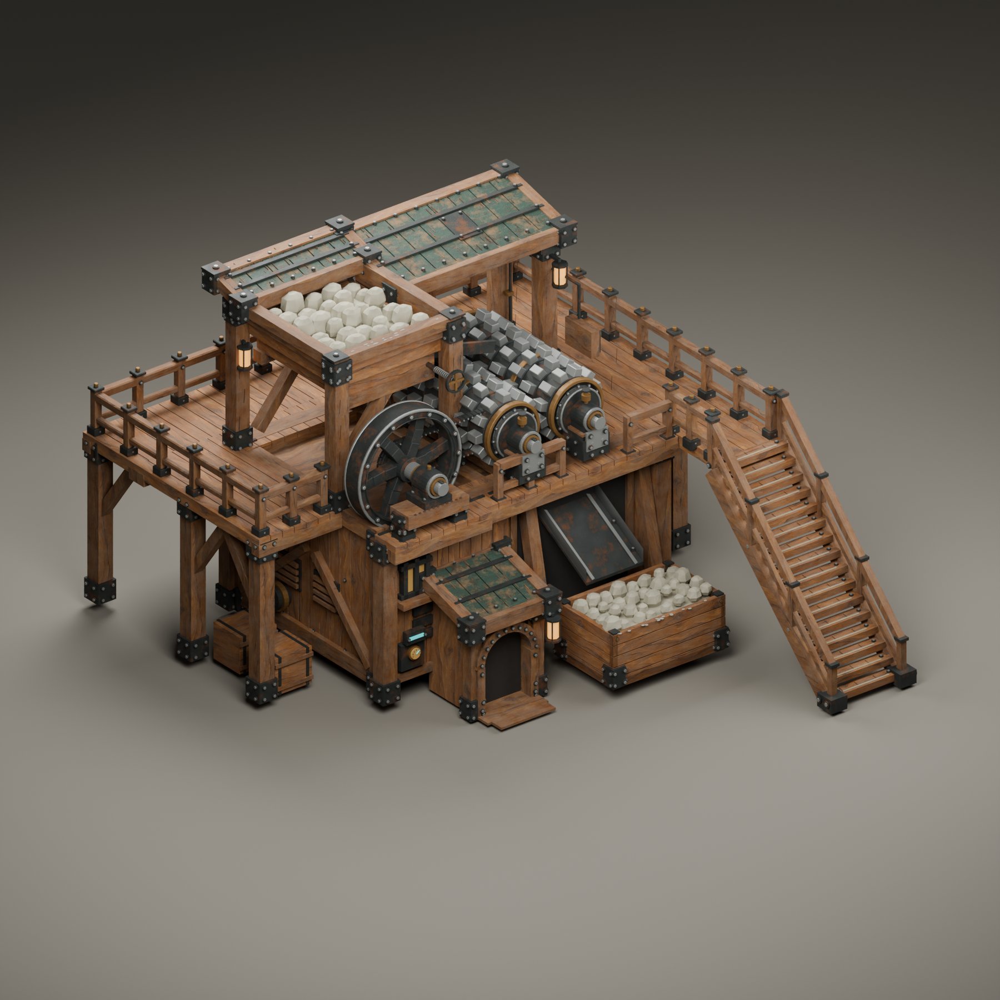
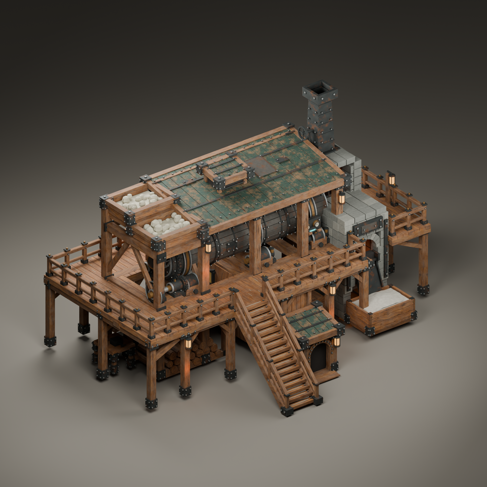

# Crusher and kiln — enclosed facades and height layers

This review continues the accepted worn crusher and covered kiln designs. It adds enclosed lower workshops, opaque framed windows, dark timber arches, exterior pipework and instruments. It also authors both working decks at **layer 2**, with rebuilt supports, walls, discharge chutes and stairs. Detailed machinery keeps its proportions and moves with its animation pivots. No beavers or visible interiors are modeled.

Both buildings follow the user's explicit arrangement: **doorway at layer 0 → porch roof at layer 1 → walkable deck at height 2**, with railings above the deck. The small pitched porch roof occupies the layer-1 band; it is not a path surface.

## Stone crusher

[Front right](StoneCrusher-front-right.png) · [Back left](StoneCrusher-back-left.png) · [Machinery detail](StoneCrusher-detail.png) · [Door and workshop close-up](StoneCrusher-facade.png) · [Two-second animation](StoneCrusher-motion.mp4)

The exposed paired rollers, flywheel clearance slot, large hopper, small covers and separate collection bin are preserved. The stair rises from layer 0 to 2 across two horizontal cells. Its supporting workshop has its own enclosed facade and service pipes.

[Geometry check](StoneCrusher-geometry-check.json) · [Motion check](StoneCrusher-motion-check.json) · [Video decode](StoneCrusher-video-check.json) · [Height manifest](StoneCrusher-height-manifest.json) · [Separate rails](StoneCrusher-rail-manifest.json)

## Cement kiln

[Front right](CementKiln-front-right.png) · [Back left](CementKiln-back-left.png) · [Machinery detail](CementKiln-detail.png) · [Entrance close-up](CementKiln-facade.png) · [Eight-second animation](CementKiln-motion.mp4)

The full roof, rotary barrel, feed towers, firebox and wide walks remain. Both stairs rise from layer 0 to 2 across two horizontal cells. The firebox has a grounded masonry base; the ingredient and discharge chutes bridge their actual receiving elevations. Exterior services and the enclosed workshop extend the worn timber/iron design.

[Geometry check](CementKiln-geometry-check.json) · [Motion check](CementKiln-motion-check.json) · [Video decode](CementKiln-video-check.json) · [Height manifest](CementKiln-height-manifest.json) · [Separate rails](CementKiln-rail-manifest.json)

## Scope and source

These are Blender renders. Checks cover source animation and loop closure, UV/material presence, separate rails, declared floor levels, and floor/headroom along the sampled service routes against static mesh triangles. They do not prove native stair traversal, idle worker placement, adaptive railing openings, runtime materials or performance. Final horizontal grid layout, occupation/support cells and native navigation still require integration, an official build and a fresh game test. The installed meshes have not been replaced by this pass.

See [height rules](../../height-layout.md) and [native walkway integration](../../../building-walkways.md). Functional height levels are explicit source constants, not export rounding. Decorative detail remains fractional; a pitched roof does not imply stack support.

Editable scenes: [crusher](../../../../src/DeepFrontier/Art/Source/StoneCrusher-ReferenceStudy.blend) and [kiln](../../../../src/DeepFrontier/Art/Source/CementKiln-ReferenceStudy.blend). Generators are `crusher_sheet_geometry.py`, `crusher_workshop_details.py`, `kiln_isometric_geometry.py`, `factory_facade_details.py`, `industrial_facades.py`, `industrial_levels.py` and `industrial_geometry.py` under `tools/asset-pipeline/`. Only the selected isometric concepts were used.
