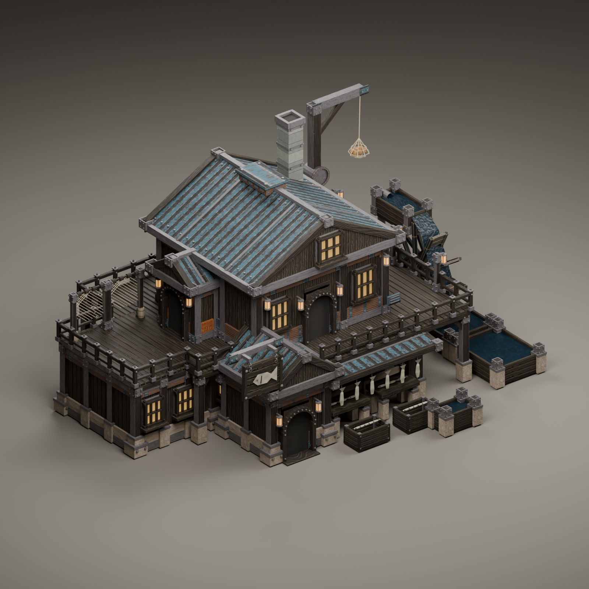
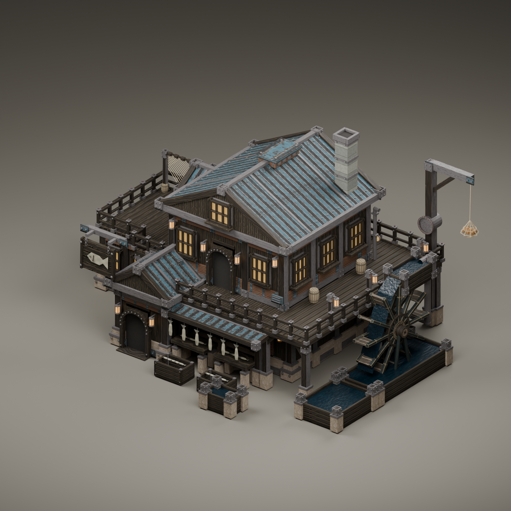
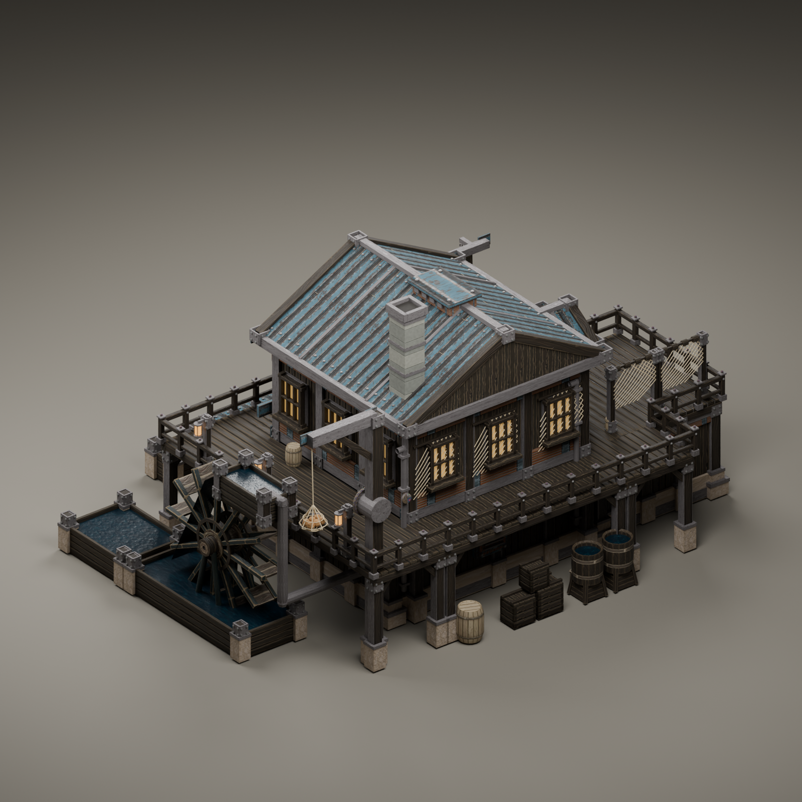

# Waterfront Fishery source review

Rebuilt from the individual [Fishery isometric reference](../../concepts/Fishery.png) after the user requested different floor and roof proportions from the Hospital/Restaurant. The top views and printed footprint counts were excluded.

The two-storey processing hall has a broad low roof, an offset entrance, a single-storey warehouse with a working roof deck, net frames, fish preparation stations, pipes, a hoist and the original native Iron Teeth wheel, tanks and materials. Three doors connect through the intended interior at ground/layer 2. Deck construction and separately placed vanilla stairs are part of the game contract.

The manifest pins the source scene, reference and evidence. Source clearance and loop checks establish authoring consistency only. See [native verification](native-verification.md) and `tools/STATUS.md` for the separately verified installed build and gameplay results.
