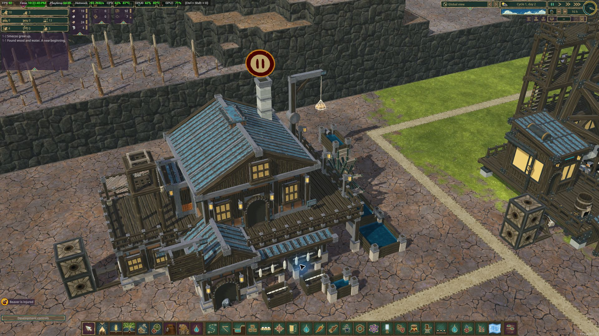
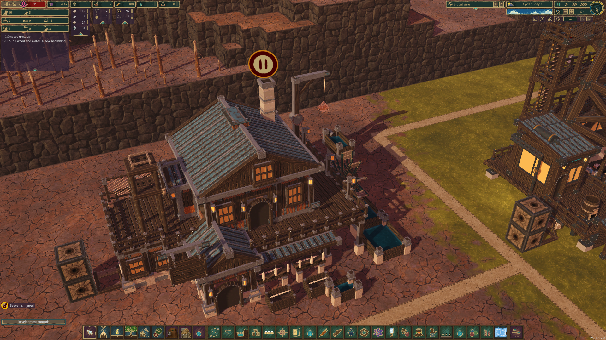

# Installed Fishery — build 51 geometry, build 54 continuation

This is the installed replacement mesh, with native Iron Teeth materials, wheel and tanks. It is separate evidence from the Blender stills. The successful production fixture is paused in this image.

`outputs/fishery-run51.log` records native placement, 80 hp demand with shaft supply, platforms and a path on the working roof, six reservoir surfaces at 0/45/90 Water, wheel movement during real production and wheel/flow stopping on workplace pause. Two production batches completed. The gatherer also caught and deposited a fish from the real pond. Native GameSaver wrote the fixture, preserved as `outputs/fishery-waterfront-verified-build51.timber`.

`outputs/fishery-reload51.log` passed fresh-process restoration, saved catch delivery, the revised geometry's native stairs, real beaver movement through both upper doors and back to the ground entrance, and deck platforms. The connected stair and side-deck rail cells opened while the neighboring unconnected panel stayed closed. Quarry reservoir and native hatchery dry/contamination/refill checks passed. The final native save is preserved as `outputs/fishery-waterfront-regression-build51.timber`.

These tests seed production ingredients and do not establish an unseeded aquaculture chain. The hatchery still uses visibly unfinished prototype artwork; `hatchery-prototype-build51.png` records that limitation. Its [replacement study](../2026-10-19-hatchery/README.md) is separate from the installed model.

Build 54's continuation passed saved hatchery stock/recipe and resumed breeding, Fishery zero-power stoppage and power recovery, real ingredient exhaustion and replenished-input recovery. It checks production progress, product events, cascade visibility and native wheel playback. The successful save is `outputs/aquaculture-continuity-build54.timber`; runtime evidence is `outputs/fishery-continuity54.log`.

Build 54 also passed a separate zero-fish-stock bootstrap. A real shore catch was deposited, the hatchery bred juveniles from it, and native workers hauled juveniles to the Fishery and produced fresh fish. Only vanilla algae/water and fixture shaft power were supplied. The source save's absence of fish stock/carrying/production was checked independently. Evidence: `outputs/fishery-bootstrap54.log`, `outputs/aquaculture-bootstrap-source.json` and `outputs/aquaculture-bootstrap-build54.timber`. This does not measure long-term food/power economics.

The continuation held the camera before taking this deck image. The older automated image named fishery-access-regression captured the following camera position because Unity screenshots are deferred until frame end, so it was renamed as hatchery-prototype evidence. Builds 52/53 stopped on fixture-only pause/assignment order mistakes; their partial results are not substitutes for the completed build 54 continuation.
