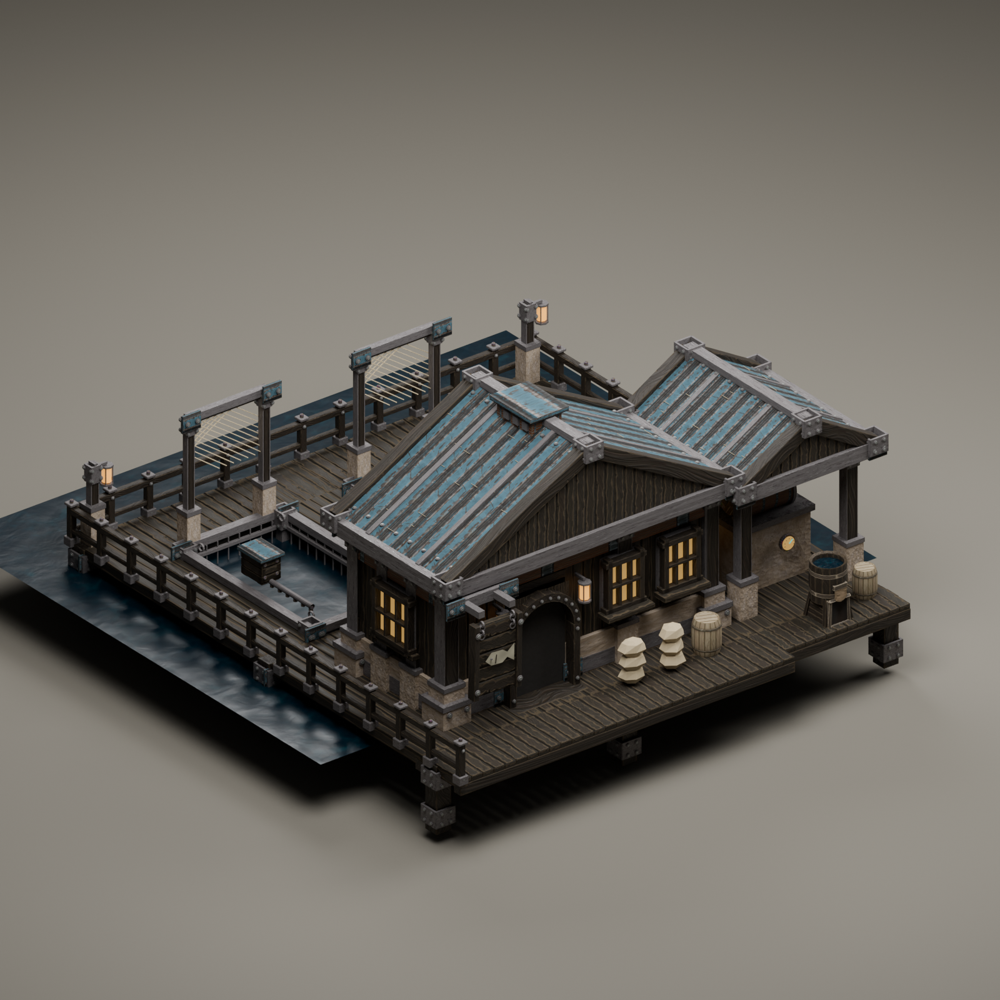
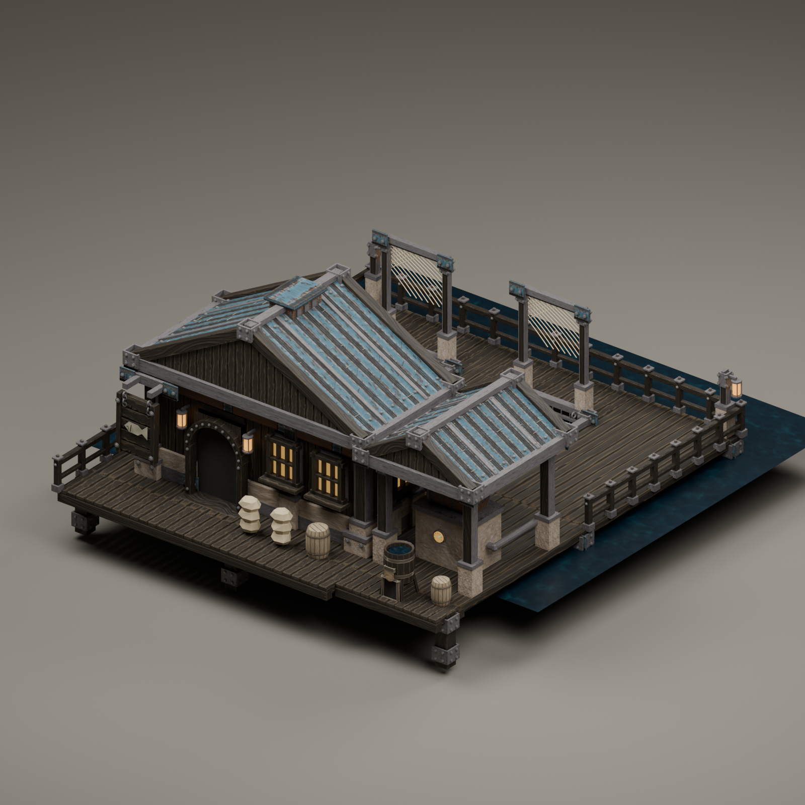
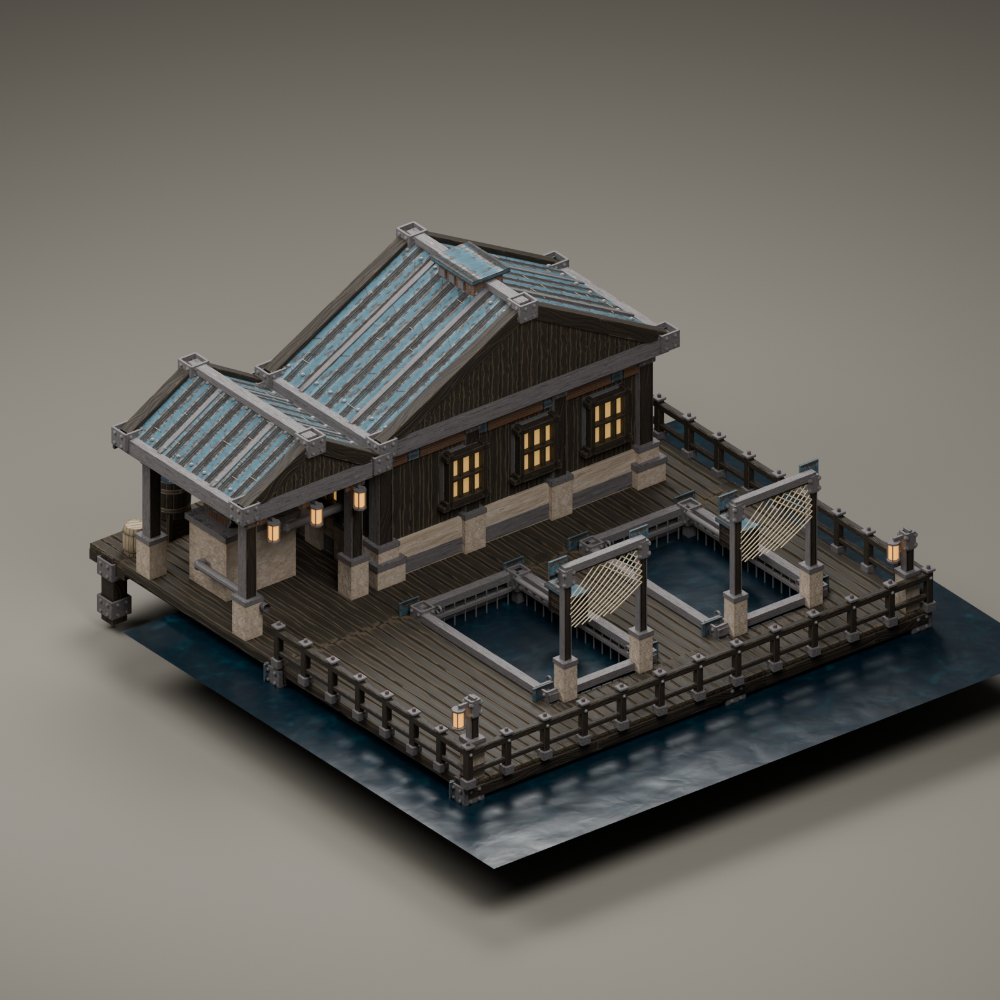
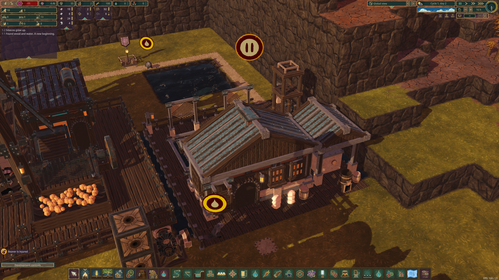

# Hatchery waterfront study

The smaller nursery uses the [Fishery reference](../../concepts/Fishery.png)'s isometric waterfront details. It has a low enclosed workroom, a separate pump canopy, two open nursery pens, net-drying frames, native barrels and a header tank. The model has a single ground-level arch, a continuous dock and separate perimeter rail pieces. It contains no character or stair meshes.

These are actual Blender renders. The water under the pens is a studio preview using the native Water material; runtime pens expose the world's real water. The header tank follows the delivered Water inventory, independently of the site's water requirement. The source manifest and clearance report are archived beside the images.

The canonical scene is `src/DeepFrontier/Art/Source/FishHatchery-ReferenceStudy.blend`. The official Timbermesh export and blueprint generator use its explicit registration without rescaling the artwork. The old 3×4×2 prototype's tests do not establish native behavior for this replacement. Current installation and test status follows below.

The explicit registration is 8×8×5, including its submerged lower layer, with BaseZ=1. Its 31 connected route cells and 20 rail openings follow the model's actual aisles. All 32 route segments passed mesh floor/headroom checks, and one complete construction cell fits the checked clear side dock. The 61-frame sign loop closes and retains at least 0.2588 units between its front edge and the entrance-lane centreline. These source checks are distinct from native placement, collision, stacking and traversal.

Native integration contract: the installed Swimming Pool uses `BlockObjectSpec.BaseZ = 1` with its entrance at local grid Z=1. `BlockObject.UpdateTransform` puts the entity/model pivot at `Coordinates + BaseZ`, while block coordinates and explicit nav edges remain relative to the lower block origin. Therefore the source dock can stay at model Z=0 while its native walking cells are at grid Z=1 and submerged cages occupy grid Z=0. Keep those two origins explicit in export, walkway positions, colliders and water probes. Source: `outputs/BlockObject.cs`.

`BuildingAccessibleSpec.LocalAccess` also transforms from the lower grid origin. Its Unity Y is 1 for the ground arch; native model slots use Y=0. Build 57 corrected that distinction and passed actual breeding and seven dock/door destinations. It also verified dry/badwater blocking, header tank levels, connected shaft power, selective rail openings and a native Double Platform + Platform + Path stack. The front apron has a 0.004-unit surface offset; native inspection showed continuous boards without the earlier terrain flicker.

The platform stack is test construction placed on the clear side dock, not part of the building mesh. The final screenshot has the workshop paused deliberately after testing. Actual world water and stored header Water are separate states; see the dry and clean-water captures alongside this image.

Build 57 passed native bank placement, 55 hp shaft supply, header levels, dry/badwater blocking, juvenile production, seven dock/door destinations, platform stacking, fresh reload and zero-stock bootstrap.

Reference nursery installed: 8x8x5, BaseZ 1, 31 route cells, 20 adaptive rail openings and one clear dock construction tile. Native appearance checked after production; bank apron no longer flickers.
