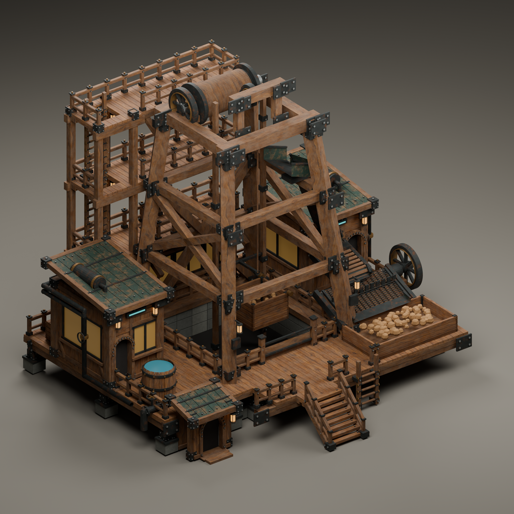

# Permanent quarry — Blender review

Original worn timber/iron quarry, based only on the front and rear isometric illustrations in [the mining concept sheet](../../concepts/01-mining-and-sources-concept-v1.png). Printed tile counts and top views were excluded.

[Process side](MineralQuarry-front-right.png) · [Rear and ladder galleries](MineralQuarry-back-left.png) · [Tipping and transfer close-up](MineralQuarry-process.png) · [16-second animation](MineralQuarry-motion.mp4)

The material route is lift bucket → tipping receiver → enclosed gravity chute → powered slat belt → vibrating screen → discharge chute → collection bin. Moving stones and the internal belt are artwork; inventory production remains the building recipe. Exterior pipes, vessels, gauges and small cyan indicators extend the worn Timberborn palette. Workshop and control-room facades are enclosed, with opaque amber windows and dark timber arches. No character is part of the model.

The source scene has 53 animated parts, including the lift, tipping bucket/load, cable, drive wheels, screen, belt rollers/slats and material-flow pieces. Separate ladders connect source elevations 1, 3, 5 and 7; the galleries and shaft barriers use 227 rail/post nodes across 25 runs.

The entrance stair now rises one whole game layer across one horizontal cell, ending at the layer-1 apron. The upper galleries are authored at layers 3, 5 and 7; the declared vertical envelope is nine layers. This is an art envelope, not a solid collision box or an arbitrary stacking limit. [Height manifest](MineralQuarry-height-manifest.json) and [height authoring rules](../../height-layout.md) record the source contract.

The latest doorway correction preserves every existing entrance and the existing layout. The ground operator doorway is at layer 0; the existing deck doorways stay at layer 1. The ground portal, doorstep and adjacent wall/support bottoms were aligned vertically. Door dimensions, X/Y coordinates, canopy and deck entrances were retained. The [height-only comparison](MineralQuarry-height-only-check.json) compares the before/after source geometry.

That comparison passed across all 284 model objects: zero X/Y vertex changes, unchanged topology and material assignments, and unchanged sampled object transforms. Only vertical coordinates in the static architecture changed.

## Evidence and remaining integration

[Geometry report](MineralQuarry-geometry-check.json), [motion report](MineralQuarry-motion-check.json), [video decode report](MineralQuarry-video-check.json), [access manifest](MineralQuarry-access-manifest.json), [process manifest](MineralQuarry-process-manifest.json), and [rail manifest](MineralQuarry-rail-manifest.json).

The Blender checks cover all 481 source frames, cable attachment/travel, ladder hatch clearance, gallery floors/headroom, and the stair-to-ladder deck route against actual static mesh triangles. They establish artwork clearance and source animation. They do not establish native pathfinding, climbing animation or gameplay.

The current five-tile gameplay quarry has not been replaced. Final grid origin, footprint, seam-aligned foundation occupations, stairs/ladder edges, entrance slots, collision, material export and adaptive-rail bindings still need integration, followed by an official build and restarted-game testing. The installed Ladder 1.0.0.4 is a candidate; its standalone unit ladder is not an automatic navigation adapter for this factory. See [building walkways](../../../building-walkways.md).

Native workshop slot/visibility components provide the intended idle worker behavior. Actual `Entrance` transforms with the standing `ForcedIdle` animation must be exported and bound before that behavior can be tested. The manifest's doorway anchors are artwork coordinates only.

Editable scene: [MineralQuarry-ReferenceStudy.blend](../../../../src/DeepFrontier/Art/Source/MineralQuarry-ReferenceStudy.blend). Producing sources: `quarry_isometric_geometry.py`, `quarry_process_details.py`, `industrial_facades.py`, `walkway_geometry.py`, and `render_reference_studies.py` under `tools/asset-pipeline/`.
