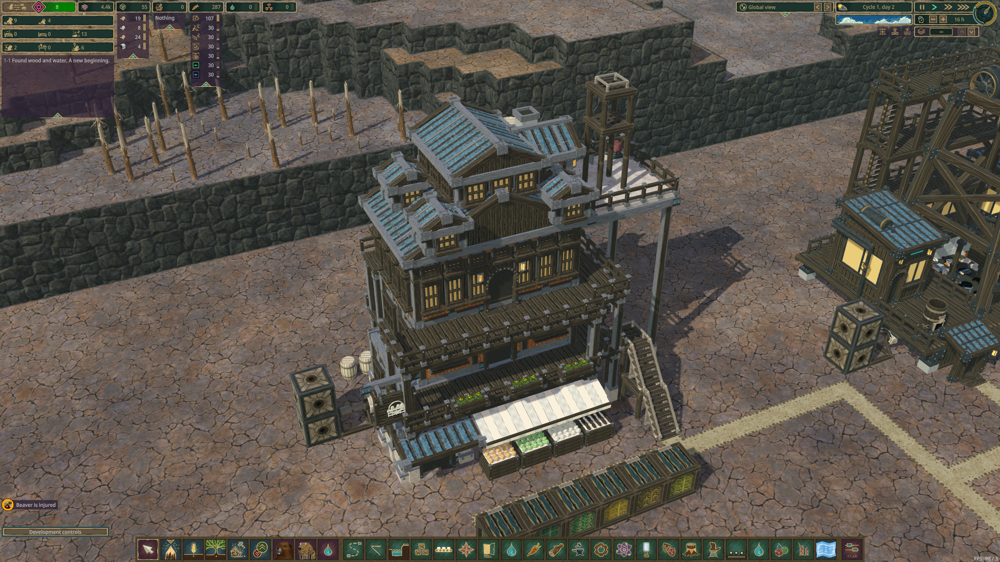
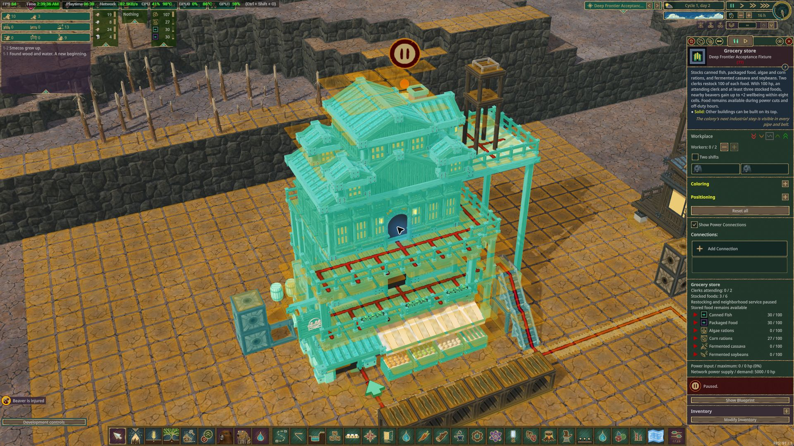
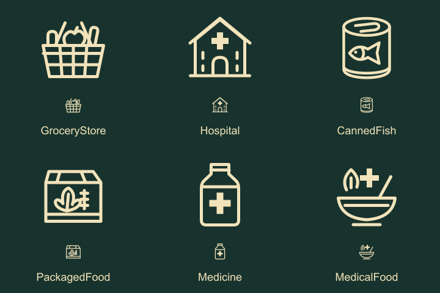
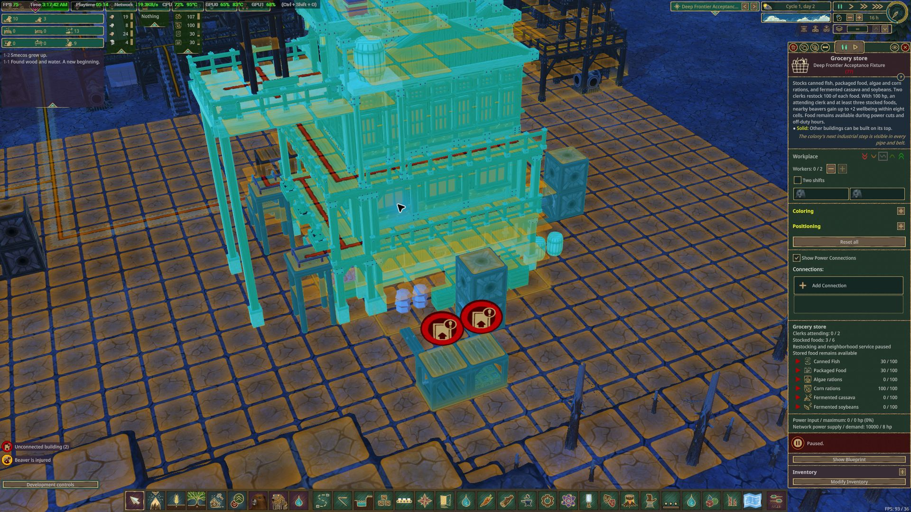

# Grocery native integration

The approved [Grocery Store reference](../../concepts/Grocery%20Store.png) supplies the isometric architecture. The existing `src/DeepFrontier/Art/Source/GroceryStore-ReferenceStudy.blend` is preserved, SHA256 `4ab1583f204e597dd82504a4d30a09269108208e63c61c60084e7a0f3c8a1e7c`. Neither the sheet's top view nor its printed tile count determines the mesh.

The exported geometry is registered at 11×9×9, with 64 route cells, 38 adaptive railing openings and doors at levels 0/2/4/6. Gallery supports use normal native stacking rules. A checked whole tile on the roof terrace supports player construction; other occupied roof cells remain architectural space. The explicit model origin is (0.4, 0, 0), which keeps the authored front-gallery waypoints in their assigned row. The ground-door waypoint is inside the existing arch. Source vertices are not snapped. The current export SHA256 is `9ca5c627b1c8c13d36e9dbe3594bf8638c76b75e516ec35c7950ce644e73c1cd`.

Twenty original native props provide the accepted plants, barrels and other detail. Closed cargo barrels are not water reservoirs. The suspended sign has a 61-frame animation track. Static checks verified the source/export hashes, native UVs, route clearance, cell support and separate rail nodes.

Initial economy values are 100 hp demand, zero output, two clerks and 6,000 science. Construction costs 80 Planks, 40 Concrete, 35 Metal Blocks and 20 Gears. One native inventory stores 100 each of Canned Fish, Packaged Food, Algae Rations, Corn Rations, Fermented Cassava and Fermented Soybeans. Clerks restock through native hauling; shoppers consume the foods' actual native effects.

The neighborhood bonus has radius eight and a two-point wellbeing cap. It requires power, an attending clerk and at least three stocked food types. Food remains available when power or staffed service stops. There is no grocery production recipe or service token.

Build 68 passed native placement, shaft supply, external vanilla stairs, supported roof platforms, selective rail openings, actual hauling of six foods, unpowered shopper entry/consumption, power/pause service gates, depleted assortment and native restocking. A real beaver reached all eight route targets through the original ground, gallery and rooftop doorways and returned to the road. Native GameSaver preserved the fixture as `outputs/grocery-verified-build68.timber`, SHA256 `f7c2cbd78f42c1737108f3b3ac68fdd6cd806ee785269a2a6e9e29226871e7ed`. Evidence: `outputs/grocery-run68.log`.

Fresh-process continuation 68 restored exact identity, paused state, food amounts, consumer permissions, resident needs and gallery connections. Staff resumed neighborhood service, a real nearby resident gained points, and an off-duty shopper entered and ate saved food. Evidence: `outputs/grocery-reload68.log`; native save `outputs/grocery-continuity-build68.timber`, SHA256 `a20543dc2317d67662c3417a51ee54fa5577515b057311aa43aebc29d1aee5ac`.

Build 67 exposed a waypoint outside its assigned cell; build 68 corrects the authored registration without changing the source art. The native panel inspection found that the generic InventoryFragment omits GivableAndTakeable goods. Build 69 uses native InformationalRowsFactory rows explicitly for the six foods. Native visual inspection confirmed all six icons/names, stock/100 values, empty shelves, clerk count and paused-service explanation. Its fresh-process continuation passed again. These economy settings are initial playtest values. Conveyor delivery remains a separate acceptance task.

The visible staircase, roof platform stack and row of food warehouses are separately placed test structures.

Six authored SVG icons replace the remaining colored civic placeholders. This preview shows both 128px and 32px sizes; the actual PNGs have transparent backgrounds. Native build 73 inspection confirmed the grocery basket, canned fish and packaged-food icons in the shop panel. The hospital, medicine and medical-food icons still need separate native panel inspection.

Physical conveyor acceptance 73 passed delivery, the exact 100-per-food limit, power loss/restoration, conserved stock and protection against outgoing belts. The saved fixture preserves ten rations on the incoming belts. Fresh-process queue acceptance 75 passed exact restored positions, delivery of all seventeen donor/queued rations and consumption-aware conservation. The final saved shelf holds 74 rations after the explicit thirty-unit test withdrawal and thirteen native shopper meals. Both belt lanes and warehouses are empty; see `docs/transport-adapters.md`.
