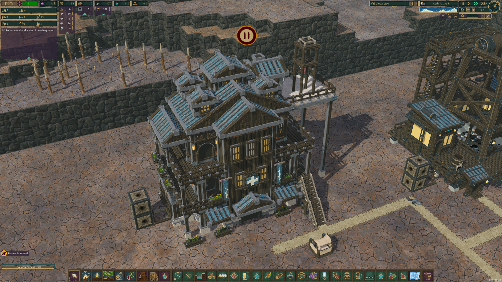

# Hospital native integration

The approved [Hospital reference](../../concepts/Hospital.png) and the preserved `src/DeepFrontier/Art/Source/Hospital-ReferenceStudy.blend` drive this building. The original source SHA256 is `fdca4cbe99e5937470c0843b067ac7fd13ef2e9fa2a9303b19cf73f3d910b602`; the native export SHA256 is `b7282094395b7bda1cb56b612dac8251432fb4159289c1868195f91b140a47a6`. Gameplay fixes have not changed that artwork.

The game registration is 12×9×9 with sparse occupation around the actual halls, 69 route cells, 50 separate railing openings, original doors at levels 0/2/4/6, and two clear roof construction cells. The native preview includes separately placed vanilla stairs and a Double Platform + Platform + Path stack on the terrace. Those test structures are not built into the model.

Initial gameplay values are 600 hp demand, zero output, six staff and thirty patient places. Construction requires 120 Planks, 80 Concrete, 60 Metal Blocks, 30 Gears, 20 Treated Planks and 25,000 science. Native treatment targets Injury +0.0303333 per active treatment hour at full staffing/power (steady native-cadence target +0.01725/hour), ChippedTeeth +0.5/hour and BadwaterContamination +0.068/hour. Native hourly supplies are two Medicine, twelve Water and one Extract, with a 24-hour buffer. The neighborhood effect supplies Public Healthcare wellbeing while staff, power and supplies are available.

Build 63 passed placement, shaft supply, stairs/platforms, thirty patient reservations, selective rails, actual care for all three conditions, separate attending staff, power/work-hour interruptions and actual walking through eight doorway/deck destinations. Its Medical Bed control measured 0.009583455/hour; the short hospital sample measured 0.01672733/hour, a 1.745439 ratio within the declared 0.08 tolerance around the 1.8 steady target. The native verified save is preserved as `outputs/hospital-verified-build63.timber`.

Build 66 passed the fresh-process continuation: exact native stock, fractional supply duration and all nine saved adult health/neighborhood records; actual inside-radius gain and outside decay; medicine exhaustion and replenishment; and three-staff injury recovery at 0.009666424/hour. The native panel was inspected, including patient/staff counts and paused care status. The verified save is preserved as `outputs/hospital-continuity-build66.timber`. Economic balance still needs colony playtesting. See [current status](../../../../tools/STATUS.md) and `outputs/hospital-run63.log` / `hospital-reload66.log`.

The isolated acceptance run compares a real Medical Bed with the hospital, checks staff/patient separation, interrupts power and working hours, then walks a beaver through the galleries and roof door before saving through the game. The separate continuation run reads exact stock/fractional-supply and patient-need expectations extracted from that successful native save, checks actual neighborhood gain inside/outside range, depletes medicine, replenishes it and checks partial staffing. Both runners require the marked Industrial Acceptance settlement and explicit launch flags.
