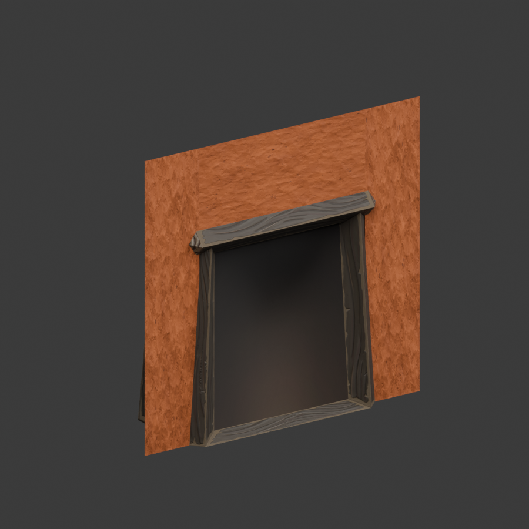
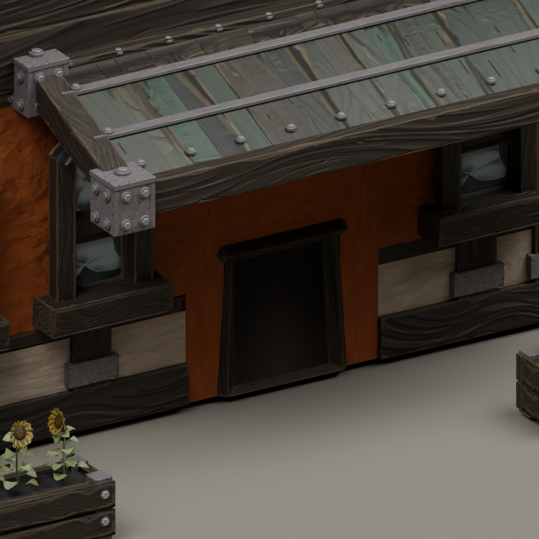
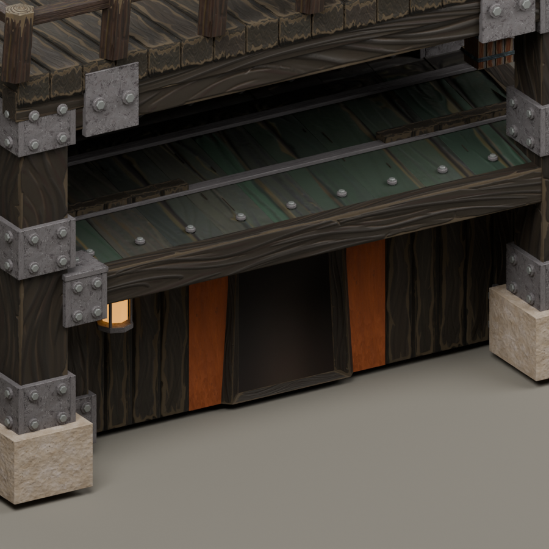
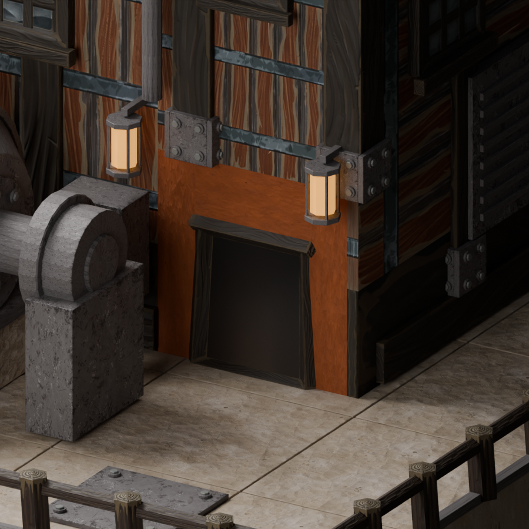
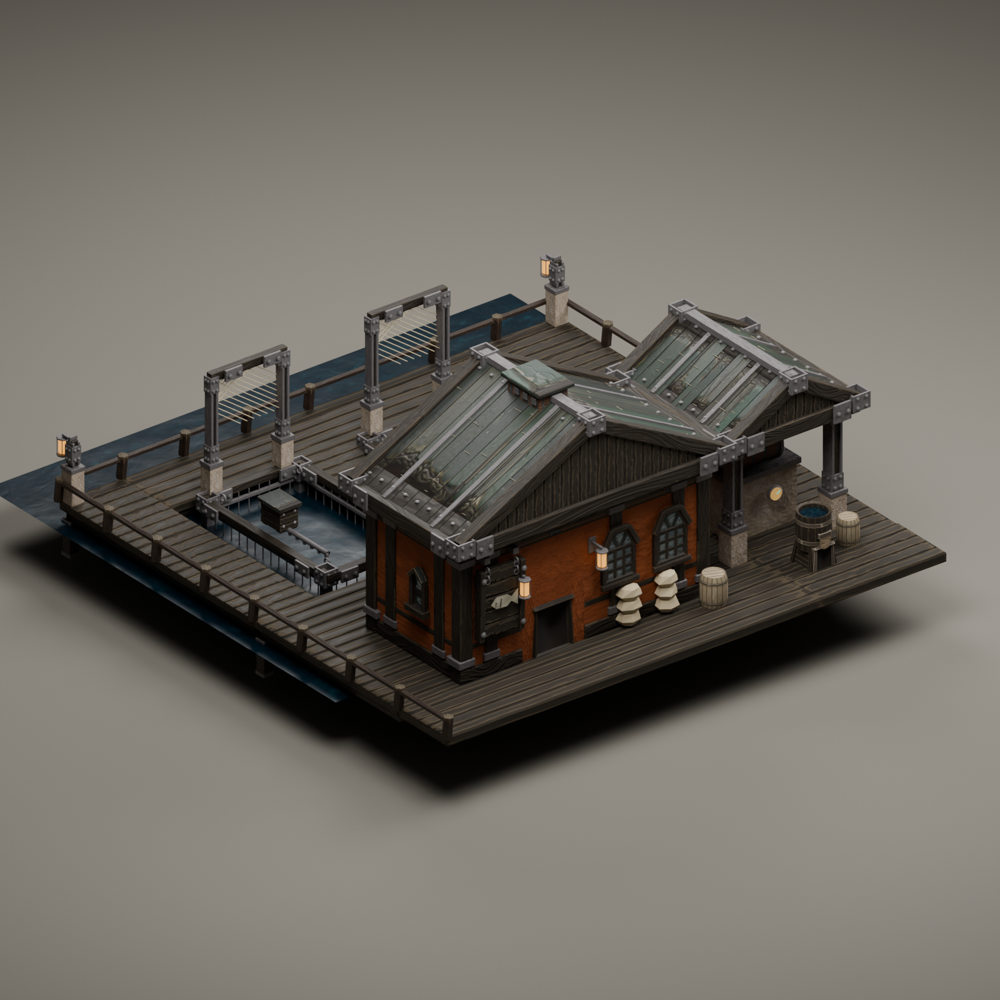
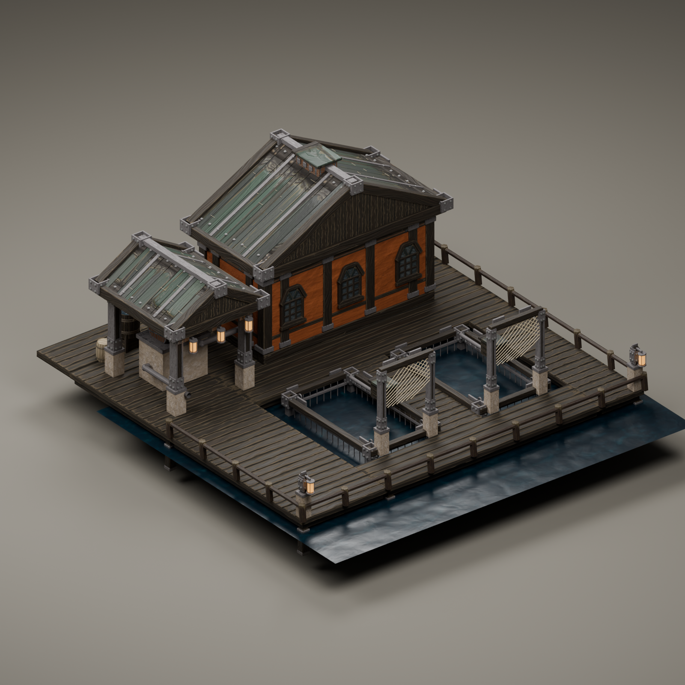

# Selected doorway authoring

Restaurant and Hospital each have four independent doorway objects with independently callable recipes. Only selected assets are rebuilt. See [the component workflow](../../../asset-pipeline.md).

This is a Blender asset preview, not an in-game screenshot. The preview generated no geometry, hid unselected meshes for this render, and did not save changes to the source. Its source SHA256 was `b73824f70ea04b97e5d4ec76b243102dc5ab5b94ef26f12f4c0d7217ef5a9c19`; another process had saved that revision after the doorway checks. The verified earlier scene is separately archived as `outputs/component-rebuilds/Restaurant-doors-verified-20261021.blend` with SHA256 `9a35ed028c37606a9625e6b77013bc0f9854f913d79248a00c88483b2920dbe1`. Keep their evidence separate.

The targeted edit regenerated four 37-face portals and preserved all 247 unselected objects. The earlier single-door mechanism check preserved 250 objects. Each rebuild report records object fingerprints, source hashes and time under `outputs/component-rebuilds/`.

The earlier verified scene passed strict overlap scanning (zero sampled visible conflicts), 118,893 source-shell probes and 17,280 one-sided coverage probes of its actual official Timbermesh export. Build115 subsequently installed the doorway components alongside independently authored window changes. Its actual installed Restaurant mesh passed a fresh 17,280-probe check (`outputs/restaurant-installed115-door-culling.json`); native rendered appearance still needs review.

This Hospital image is also a Blender preview, rendered from the saved scene without regenerating geometry or saving source changes. Source SHA256: `71e72c516cd3b87de22dbc7c84f8fc10daf4a9e6a20df3ac986f272aaaa24a6b`. The four-door update preserved 259 other objects and 34,470 architecture faces. Its official export passed strict overlap scanning and 17,280 one-sided coverage probes. The independent build116 subsequently installed those two meshes and verified the package. The user reported the doors look fixed; these source images remain distinct from a recorded native test.

These saved-scene previews show the corrected native timber casing in front of the orange plaster. Only one 37-face portal was rebuilt per building, preserving 134 other Mixer objects and 81 other Turbine objects. The source meshes passed fresh strict overlap checks. Their actual exports each passed 4,320 one-sided doorway and wall-joint probes. Source hashes: Mixer `0c07e11023c10f551a10724f39aed667e650011fe285d73a3af4d54d4ddf4737`; Turbine `a283faae6122452ae545aaf7f95a1fc10a55004d7fce80cfedadd47b554f80a2`. Installation and fresh native appearance are recorded separately in STATUS.

These Hatchery previews come from the saved component scene, not the game. Seventeen components now define the enclosed headhouse, one-tile door, windows and platform-like docks. The final apron correction rebuilt only two components and preserved all71 other objects. The candidate render hash is `ba3f6111a77c2a811df41fcb4d84df27077ce90643bcd418b7aad0cdcb5a179e`; its canonical source is `339ff5e714b351092f7431dbd69edf971199e7b9f8c5b15b63b7feb4090fa44e`. Separate saves account for the file hash difference, and all ten derived manifests match. Source checks cover terrain clearance, exterior coverage, window mounting, UVs and usable dock space. Actual official export `24135f27694a6d6c45dfaeec07465cc213891bbd9e2ed46b997a1896934a57ae` also passed doorway coverage and blueprint binding checks. Native placement, path selection and rendered appearance remain pending.
