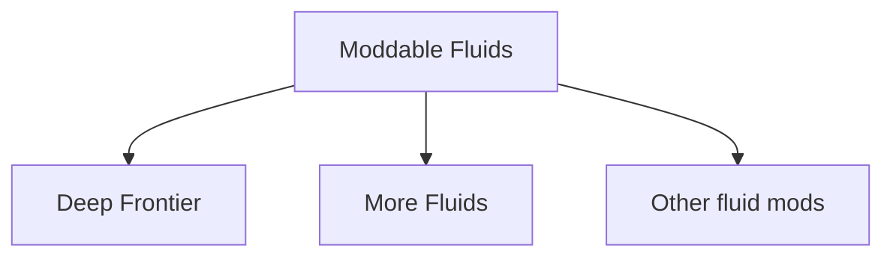

# Moddable Fluids and More Fluids development plan

Draft started 2026-11-06. Initial target: the installed Timberborn 1.1.2.8 development environment. The [multi-fluid transport prototype](fluids-transport-prototype.md) and [native stage adapter](fluids-native-adapter.md) pass standalone .NET and installed-Mono probes. The official Mod Builder has installed a separate flag-gated development package, and its actual core/bridge DLLs also pass the Mono probe. The scene owner and disposable fixture compile; real-worker settlement acceptance is pending. Since 2026-11-09 the [0.1 contract](fluids-api-contract.md) has a public registry, providers, discovery, persistent component identities and save round trips. These are verified outside the game only. The game-side saver, shared rendering and the More Fluids package do not exist yet.

Build two new mods: **Moddable Fluids**, which provides a shared world-fluid system, and **More Fluids**, which adds liquids using that system. Migrate the existing **Deep Frontier** mod to depend on Moddable Fluids and register its radioactive water through the same public interfaces available to other creators. A third creator should be able to add a juice tide that works alongside both mods without implementing fluid transport, saves, or rendering again.

The agreed direction is the dependency split, shared registration model, and an open API that supports reflection and advanced integrations. Creators can use definitions, compiled C# references, reflection, and runtime patches as their integration requires. The contracts, defaults, and milestones below are proposed starting decisions. Oil that floats and lava that makes obsidian remain intended extensions, with separate feasibility work before they become supported API features.

## Mod responsibilities

Arrows point from the foundation to its consumers. Deep Frontier and More Fluids each require Moddable Fluids. More Fluids should also work without Deep Frontier; interactions that need Deep Frontier belong in an optional integration.

| Package | Owns | Examples |
| --- | --- | --- |
| Moddable Fluids | Registry, shared composition and transport, source and intake commands, sampling, world-water rendering, persistence, generic integration hooks, coordinated tide support | Register a fluid; emit a mixture; inspect a reservoir; read a named fluid with a sensor |
| Deep Frontier | Radioactive water definition and nuclear gameplay | Radioactive tide, irradiation, soil radiation, reactor spills, recovery and shielded storage |
| More Fluids | Additional fluid definitions, effects, art, settings, and content | Coffee, saltwater, healing water; later oil and lava if their simulation is supported |
| Other creators | Their own definitions and content through the public API | Juice tide, new sources, fluid-aware buildings, custom treatment systems |

Moddable Fluids ships no extra playable liquid. It exposes the game's existing fresh water and badwater through built-in definitions. Development fixtures can register synthetic fluids in a separate test mod.

Use working mod IDs `ModdableFluids` and `MoreFluids` until names and publication IDs are finalized. Give each package its own manifest, assembly, version, and official Mod Builder output. Consumer packages reference the installed API assembly; they must not embed another runtime copy. Detect conflicting loaded API versions and duplicate registration visibly instead of starting a second simulation. Verify the game loader's handling of duplicate local and Workshop installations during packaging work.

## Existing implementation and constraints

Deep Frontier already tracks fresh, bad, and radioactive shares within native water columns. Radioactive water follows native simulation substeps through a shadow contamination array. Native badwater remains in `WaterColumn.Contamination`. The renderer extends the native water surface; it does not draw a separate radioactive liquid layer.

| Existing source | Reusable foundation or migration responsibility |
| --- | --- |
| [RadiationSimulation.cs](../src/DeepFrontier/Scripts/Radiation/RadiationSimulation.cs) | Column geometry reconciliation, queued additions, source tracking, lifecycle, snapshots, and versioned persistence |
| [RadiationLockstep.cs](../src/DeepFrontier/Scripts/Radiation/RadiationLockstep.cs) | Version-checked native water hooks and substep scheduling |
| [RadiationMixing.cs](../src/DeepFrontier/Scripts/Radiation/RadiationMixing.cs) | Addition/removal arithmetic and evidence about native kernel limits |
| [RadiationRenderer.cs](../src/DeepFrontier/Scripts/Radiation/RadiationRenderer.cs) and [RadiationShading.cs](../src/DeepFrontier/Scripts/Radiation/RadiationShading.cs) | Water shader integration, scene cleanup, and changed-row uploads; separate water support from radioactive soil rendering |
| [IRadiationService.cs](../src/DeepFrontier/Scripts/Radiation/IRadiationService.cs) | Existing Deep Frontier consumer boundary, units, and radiation tuning |
| [RadioactiveTide](../src/DeepFrontier/Scripts/RadioactiveTide) | Native weather integration, optional Moddable Weathers integration, per-save settings, UI, and source emission |

Three constraints shape the extraction:

1. **Independent native contamination passes do not preserve a complete mixture.** The existing code documents cases where badwater plus radioactive share exceeds one. Its `KernelExcess` rule deposits excess radioactivity into soil. That is a Deep Frontier rule, not a valid universal destination for coffee or juice. Prove a transport calculation that respects the complete composition before extending the current method to many fluids.
2. **A native water column has one hydraulic body.** Extra shares do not create independent oil and water surfaces, density ordering, or different flow speeds. Layered fluids need additional simulation and rendering.
3. **Inventory liquids and world liquids have different contracts.** Timber Pipes transports registered `Liquid` goods through native inventories. Arbitrary new world-fluid mixtures do not automatically travel through those networks. Pumps and dumps need explicit conversion rules.

The installed game and dependency contracts remain the authority. Keep native APIs where available and isolate the demonstrated extension gaps behind version-checked adapters. [Radiation notes](radiation.md), [transport adapters](transport-adapters.md), and [current verification status](../tools/STATUS.md) contain the existing behavior and evidence.

## First release API

### Fluid registration

A content mod registers a namespaced, case-sensitive ID such as `DeepFrontier.RadioactiveWater`, `MoreFluids.Coffee`, or `ExampleCreator.Juice`. Definitions record the owning mod and contain display/localization keys, appearance properties, and references to explicit behavior policies. Freeze the registry before loading world fluid state. Registration order must not change results or saved identity.

Validate duplicate IDs, missing referenced definitions, unsupported behavior settings, and nonfinite or negative quantities. Reject invalid definitions with the owning mod and fluid ID in the error. Keep canonical IDs as authored; do not normalize them or invent aliases. Renames use explicit versioned migrations supplied by the owner.

Start with blueprint-authored definitions for ordinary content and C# providers for custom behavior. Both paths feed the same registry and validation. Exact types and field names are determined by the prototype; the API needs these capabilities:

| Public capability | Contract |
| --- | --- |
| Definition lookup | Resolve a stable fluid ID and inspect supported properties |
| Mixture sampling | Return native total volume, surface/column geometry, and component volumes or shares from one consistent snapshot |
| Fluid addition | Queue a measured pure fluid or complete mixture into an open native column |
| Source emission | Register owned, removable emitters and composition overrides; return handles instead of exposing a global last-writer setting |
| Intake requests | Define accepted fluid components and separation behavior; report actual removed quantities after the native change applies |
| Behavior policies | Evaluate exposure, irrigation, intake suitability, and explicit fluid transformations at documented simulation stages |
| Appearance registration | Supply colors and supported material properties to the shared water renderer |
| Tide registration | Supply an ID, eligibility, settings, presentation, and source composition through coordinated weather adapters |
| Extension discovery | Find the API, its version, registered services, and supported extension capabilities through documented public members, including reflection |

Ordinary public samples use coordinates and immutable values so querying water does not require `WaterSimulator`, mutable native arrays, or internal column indices. A query by 3D cell must identify the actual open column at that height, including reservoirs separated by platforms or terrain. Advanced integrations can access additional services through explicit capabilities; keep the ordinary sampling contract independent of native implementation details.

Publish the queue timing clearly: additions and removals are requests, not immediate mutations. Use completed intake results to create inventory goods. Deliver ordinary gameplay callbacks at a defined main-thread stage, and document when their commands take effect. Advanced computation hooks need an explicit data-access and scheduling contract so extensions can participate without racing the water simulation. Unity calls still require the appropriate game thread.

### Reflection and advanced extensions

Reflection is a supported way to discover the foundation, inspect definitions, register providers, query fluid state, and invoke public services. A creator should be able to build an optional integration without a hard assembly reference to Moddable Fluids. Give that route a documented entry point, version and capability discovery, and the same registry and runtime behavior as compiled consumers. Do not require reflection callers to impersonate an internal implementation class.

Provide public registration adapters and callback binding for the reflection route so a consumer can supply documented values and delegates without implementing an API interface at compile time. Validate those adapters against the same typed contracts used by compiled providers. The external example must prove this works in the game's runtime.

Treat public assembly names, type names, namespaces, member names, and signatures as compatibility commitments for both compiled and reflected use. Keep discovery members unambiguous, and add optional capability interfaces instead of repeatedly changing existing signatures. Publish deprecation and explicit major-version migration guidance when a contract must change. Preserve the metadata and entry points needed for reflection in official release builds; verify the built package, including any Unity stripping behavior.

Make core assemblies safe for type enumeration, attribute inspection, and service discovery with optional mods absent. Timberborn and dependency discovery can enumerate assembly types; a public type that inherits an interface from an absent optional assembly can break that process. Keep such types in optional bridge assemblies and verify the exact installed loader behavior. Discovery should report a broken required provider and its cause, rather than silently skip it after a type-load exception.

Use public interfaces, provider registration, events, and explicit extension stages for custom effects, reactions, intake logic, visuals, and future simulation backends. Keep extensible concepts open to new provider implementations rather than a closed enum of liquids or effects. Support namespaced custom metadata and versioned provider-owned save data so a creator can add a property such as sweetness or magical charge without modifying the core schema. Define registration and activation stages for providers discovered through reflection; the same world-state validation applies to every registration route.

Expose extension ordering and ownership explicitly. Several observers can inspect the same stage; transformations use measured commands and a defined commit stage. Stateful providers receive load, save, and unload hooks, and scene teardown releases registrations and subscriptions. An extension that replaces a core stage must declare the capability it replaces and its compatibility requirements. Diagnose competing exclusive replacements before simulation starts. This permits deeper customization while retaining one shared authoritative fluid state.

Do not block mods merely for using reflection, Harmony, or access to game or API internals. Give recurring integration needs supported hooks so creators can reduce their dependence on internal layouts. Advanced authors may still use private reflection or patches, with version-specific signature checks. Public contract compatibility is testable; arbitrary changes to private game or API members cannot carry the same stability promise. Provide a diagnostic version/capability report so integrations can state exactly which runtime they support.

### Composition and transport

For the first release, each mixable fluid occupies a nonnegative part of the native water volume. Fresh water is the explicit remainder after badwater and all registered extra components. For a wet column, all component volumes total the native water volume within a defined numerical tolerance. A sample's shares total one. These are volumetric gameplay components; adding a separate model for dissolved salt mass or temperature requires a later contract.

Native badwater must retain its game behavior. The transport prototype must resolve how all extra components share the remaining non-bad volume during flow, diffusion, evaporation, native sources, selective native removals, and column geometry changes. Compare its results with the current radioactive-water model and identify any intentional change before migration.

Use a shared transfer calculation for the complete mixture. Do not independently run one native kernel per fluid and then normalize, clamp, or discard the resulting surplus. Diagnose invalid producer calculations at their source. Record additions, removals, off-map discharge, evaporation, geometry loss, and declared transformations so conservation failures are attributable.

Distinguish a display or intake detection threshold from physical deletion. Deep Frontier's existing 0.5 percent radioactive cutoff deliberately removes small amounts under specific conditions. Keep that policy with Deep Frontier and account for it as an explicit transformation; do not apply it to all fluids. Likewise, radioactive decay, soil deposition, and washout remain registered Deep Frontier behavior. The generic transport must report loss and exchange quantities without assuming a soil-radiation sink.

Keep volumes in documented native water units and rates in native volume per game hour. Give each world-to-good conversion an authored volume per good. Retain Deep Frontier's existing radioactive conversion of 0.2 native volume per `RadioactiveSludge` good during migration.

### Shared appearance and performance

One foundation service owns the world-water material integration. It computes mixture appearance from registered definitions and supplies the native water geometry with the required data. Validate pure colors, mixed colors, transparency, and scene unloading. Deep Frontier keeps its soil shader contribution through an explicit integration boundary.

Choose a runtime composition texture or resolved appearance texture after measuring the prototype. Consumer mods must not need their own replacement water shader for an ordinary new color. Additional visual properties such as emissive lava require declared support rather than arbitrary consumer shader swaps.

Reuse one native flow snapshot and geometry view per relevant step. Track active fluids and changed areas so merely registering unused fluids does not create a full-map simulation pass for every definition. Measure memory, simulation time, and render uploads with increasing map sizes and active fluid counts before fixing storage layouts or supported limits.

## Connection points and coexistence

| System | Shared connection | Content responsibility |
| --- | --- | --- |
| Sources and outfalls | Owned emission requests with measured composition and rates | Source buildings, unlocks, visual effects, and emission settings |
| Pumps and workshops | Intake acceptance, proportional removal, explicit separation, and completed results | Decide which mixtures are usable and which goods result |
| Inventories and Timber Pipes | Explicit world-to-good and good-to-world conversion | Storage restrictions, pipe ports, recipe inputs, and product IDs |
| Irrigation and planting | Evaluate registered policies through one native adapter | Decide whether a fluid irrigates, blocks growth, or harms plants |
| Beavers and bots | Exposure context with fluid sample and time exposed | Apply needs, injury, healing, radiation, or other effects |
| Sensors and sluices | Select a registered fluid ID or an explicitly defined aggregate | Friendly labels and any special automation behavior |
| Stream gauges and inspection | Display component shares from the shared sample | Additional diagnostics specific to a fluid |

Avoid one universal contamination number. Radiation, salinity, healing, drinkability, and irrigation are different properties. Define named aggregate queries only where their semantics are clear. An unknown fluid must not become drinkable or irrigating simply because the native engine represents its volume as non-bad water. Establish explicit acceptance defaults and preserve existing vanilla fresh-water and badwater behavior.

For independent effects, pass the same sample to each provider. Healing water does not implicitly remove radioactive volume, and radioactive water does not erase coffee. Physical conversion requires a declared transformation. Define combination rules per shared decision: for example, any required intake refusal blocks that intake, while independent need effects may both apply. Test conflicting effects rather than claiming the API can reconcile arbitrary gameplay rules.

Two creators may intentionally register different juice IDs; those are distinct components. A creator who wants to use an existing canonical fluid references its owning mod and definition. Identical display names do not merge fluid identities. Cross-mod reactions belong to one declared integration owner, with duplicate or ambiguous rules rejected.

### Tides and weather

Provide coordinated tide registration as part of the foundation package, with adapters for native weather and optional Moddable Weathers. Reuse the installed weather mod's scheduling where it supports the required behavior. Keep optional dependency types out of assemblies loaded without those dependencies.

The proposed native-weather default is one selected hazardous weather per cycle. Registered tides supply eligibility, chance or weight, cooldown, duration, source targets, and presentation. Specify selection semantics before implementation: several independent percentages must not accidentally become a load-order competition or silently change the total hazard rate. Preserve vanilla and existing Deep Frontier probabilities in their corresponding single-content configurations, then expose an explicit combined policy for several tide providers.

All tide emissions use source-specific owned requests. Define conflict handling for multiple source overrides, including a tide interacting with a permanent spring. An unsupported overlap produces a clear error; mod load order must not select a winner. Tides transform only the new volume emitted by the targeted source, without recoloring the entire river instantly. A source with zero native strength emits zero extra fluid.

Save selected weather identity, duration, cooldown history, and the settings used by that game. Restore the active tide before weather readers run after load. Weather Station choices and warning UI use registered tide IDs. Fluid content mods should not each patch the native randomizer, weather UI, sound switch, and source loop.

#### Combined tide-selection proposal

This is a proposal; the user has not chosen a policy. The [extraction inventory](fluids-extraction-inventory.md#8-tide-selection-as-implemented) records the current behaviour, and [model_tide_selection.py](../tools/model_tide_selection.py) computes the figures below. That script is an exact Markov model of two installed rules: the native `HazardousWeatherRandomizer`, whose badtide chance changes with the current streak (and a tide in the history counts as a non-badtide streak), and Deep Frontier's one-cycle tide cooldown. Its output is `outputs/fluids-api-prototype/tide-policy-model.json`.

Inputs:

- Every vanilla mode has `ChanceForBadtide` 0.4. Randomizing starts after cycle 5 on Easy, 4 on Normal and 3 on Hard; drought is guaranteed until then.
- Deep Frontier's tide chances are 15, 25 and 35 percent on Easy, Normal and Hard.
- More Fluids has no tide yet. The table assumes a coffee tide with Deep Frontier's rules at 25 and at 15 percent.

All shares are long-run, once every weather is eligible.

Requirements for any policy:

- Vanilla-only and Deep-Frontier-only games keep exactly their current probabilities.
- No combination exceeds 100 percent.
- Mod load order never matters.
- Each tide keeps its own per-save settings, cooldown and eligibility.
- The Moddable Weathers path produces the same shares through one adapter that converts all registered tides to weights once. This avoids the mutual `GetChance` calls in the current Moddable Weathers integration.

| Case (Normal unless stated) | Policy | Drought | Badtide | DF tide | MF tide |
| --- | --- | ---: | ---: | ---: | ---: |
| Vanilla only (any mode) | native | 59.7% | 40.3% | – | – |
| DF only, Easy / Normal / Hard | current | 52.2 / 48.1 / 44.5% | 34.8 / 31.9 / 29.5% | 13.0 / 20.0 / 25.9% | – |
| DF 25% + MF 25% | A. Load order: each later patch overrides the earlier one (status-quo hazard) | 38.0% | 25.2% | 16.8% | 20.0% |
| DF 25% + MF 25% | B. Additive: each tide takes its own chance of the cycle; the native draw gets the rest | 36.1% | 23.9% | 20.0% | 20.0% |
| DF 25% + MF 25% | C. Shared budget (the largest chance), split by chance, cooldown per tide | 45.1% | 29.9% | 12.5% | 12.5% |
| DF 25% + MF 25% | C′. Shared budget with a global cooldown: no tide in the cycle after any tide | 48.1% | 31.9% | 10.0% | 10.0% |
| DF 25% + MF 25% | D. Independent rolls; if several succeed, pick one in proportion to their chances | 38.0% | 25.2% | 18.4% | 18.4% |
| DF 25% + MF 15% | B. Additive | 40.3% | 26.7% | 20.0% | 13.0% |
| DF 25% + MF 15% | C′. Shared budget, global cooldown | 48.1% | 31.9% | 12.5% | 7.5% |
| DF 25% + MF 15% | D. Independent rolls | 41.6% | 27.6% | 19.2% | 11.6% |

Policy A is rejected because it lets load order decide.

Policy B is the simplest, but its shares can exceed one when several tide mods are installed. It would then need a rule to reject or cap them, and capping is the scaling this plan forbids.

Policies C and C′ keep the game's total hazard close to the single-content difficulty. C′ matches it exactly, at 20 percent. The cost is that installing More Fluids halves how often the Deep Frontier tide appears.

Policy D is the recommendation. It reproduces vanilla and Deep Frontier exactly when they are alone, never exceeds 100 percent, does not depend on order, and composes for any number of tides. Combined, each tide appears close to its advertised rate (18.4 percent against 20). The total tide rate grows as 1 − Π(1 − cᵢ), and each tide's per-save chance setting stays the player's control over difficulty.

To implement D:

1. Run the native drought/badtide draw first, as now.
2. Roll every eligible tide once.
3. Among the tides whose roll succeeded, choose one with a single weighted draw over their chances, in ordinal tide-ID order.
4. Record the chosen tide's ID in the native history.

If the user prefers constant difficulty, choose C′.

## Saves and version compatibility

The foundation owns the world-fluid save schema. Save stable fluid IDs and owning mod/schema versions with component state. Runtime numeric handles can speed up lookup but are rebuilt from the registry and never serve as persistent identity. Persist cells and column geometry sufficiently to restore reservoirs at different heights, following the existing reconciliation requirements.

Proposed missing-provider policy: if a save requires a fluid or behavior provider that is unavailable or incompatible, stop loading it with a clear explanation naming the missing mod and IDs. Do not replace unknown fluid with water or let a new save erase it. A future explicit removal/conversion tool can make mod removal possible; it needs its own measured conversion and save-copy workflow.

Use versioned migration readers for the existing `DeepFrontier.Radiation` formats and preserve the current version 2 sludge-to-mixture migration route. Import radioactive water into the API once; retain soil, radiation sources, pump buffers, and other Deep Frontier state with their appropriate owner. Distinguish an ordinary newly added API from a partially migrated or inconsistent save. Validate and apply migration before resuming simulation, and publish the new format only after a successful complete save.

After migration, prevent the old and new simulations from both reading or writing authoritative water shares. Keep a temporary `IRadiationService` facade backed by the API so reactor, bot, storage, and exposure code can migrate incrementally. Preserve existing goods IDs, entity state, tide settings, and radioactive gameplay rules unless an explicitly documented transport correction requires a change.

Version the public API and schema separately from content balance. Test older compiled and reflection-based consumer builds against compatible foundation updates. Breaking contract changes need a declared major version and consumer requirements. Packaging verification must confirm that one enabled foundation runtime supplies every consumer.

## Deep Frontier extraction map

| Area | Foundation destination | Deep Frontier responsibility |
| --- | --- | --- |
| Column state and water lockstep | Generic composition, native adapter, geometry and lifecycle handling | Radioactive definition and migration reader |
| Mixing arithmetic | Shared measured additions, removals, and transport | Radiation-specific cutoff, decay, deposition, and washout policies |
| Water rendering | Shared mixture appearance and native water shader integration | Radioactive appearance values and soil rendering |
| Springs, outfalls, intake | Generic emitters and intake results | Existing buildings, buffers, product conversion, and balance |
| Radioactive tide | Shared weather registration and emission adapters | Existing tide ID, settings, art, and eligibility rules |
| Sensors and weather readers | Registry-based choices and shared sampling | Preserve saved radiation choices and existing UI behavior |
| Exposure and storage | Generic sampling and interaction hooks | Irradiation, zombies, hospital effects, hazardous deletion and storage rules |

Audit consumers that directly inject `RadiationSimulation`, including soil, storage, spring, and renderer code. Changing only `IRadiationService` would leave those systems coupled to the old implementation. Remove duplicate water and weather patches as the corresponding shared adapter takes ownership.

Use separate `src/ModdableFluids/` and `src/MoreFluids/` roots alongside `src/DeepFrontier/` initially. Keep the public contract independent of the Deep Frontier namespace and avoid dependencies on its content generators or assets. Extend the official build workflow to build and verify each package independently, including optional assemblies and supported platform bundles.

## More Fluids content direction

Start with one simple mixable liquid to prove the consumer workflow, then expand the pack. The following are candidates rather than approved balance rules:

| Fluid | Potential gameplay | Design choice to settle before implementing |
| --- | --- | --- |
| Coffee | Brown tide; recovery into a Liquid good; caffeine or wellbeing effect | Exposure versus consumption, dilution, and usable pump output |
| Saltwater | Water unsuitable for ordinary drinking or irrigation; desalination | Volumetric saltwater component in the initial model versus a later dissolved-salt model |
| Healing water | A beneficial exposure or treatment effect | Which conditions it affects, rate, and how mixed hazards remain active |
| Oil | Recoverable resource, surface slick, and layered containment | Independent phase simulation and depth-specific intakes |
| Lava | Hazardous flow and solidification on contact with water | Supported flow model, reaction quantities, and obsidian representation |

Deep Frontier owns radioactive water for the first release. More Fluids references that definition only through an optional integration when needed. It does not register another copy when Deep Frontier is present. Give the external developer example its own package and namespace so it demonstrates using only the documented API.

## Layered fluids and reactions

Oil floating on water requires an independent phase: its own volume, density ordering, interface height, lateral movement, and intake selection by depth. A shader slick alone cannot establish correct floating behavior. Prototype a closed layered pond, two connected ponds, an overflow edge, and top/bottom intakes. Then verify mixing restrictions, geometry changes, and save/reload before promising immiscible registration to creators.

Design the initial sampling boundary so a later sample at a specific height can identify a phase. Do not expose unused density or viscosity fields that appear to work in the mixable implementation. Independently moving phases may require a new solver or substantial native integration; decide that from the prototype.

Lava and water need a reaction system with explicit reactant volumes, contact area, rate, and products. A reaction inside a mixed column differs from contact across an immiscible interface or between neighboring columns. Compute reactions from a stable snapshot, arbitrate competing requests deterministically, and commit the resulting removals/additions once. Registration order must not decide which reaction consumes shared fluid first.

For obsidian, first decide whether the result is native terrain, a placeable solid entity, or a resource deposit. Verify the actual placement API, water displacement, occupied cells, structural effects, and navigation updates. Queue solidification at a native-safe tick stage. Commit fluid consumption only with a valid solid-placement result; failed placement must not delete reactants. Test whether partial reaction amounts accumulate before forming a whole block and how repeated contact is saved.

Keep a full temperature/heat simulation outside the initial plan. Lava may use authored contact and cooling rules if those produce the desired gameplay, subject to the later prototype.

## Delivery milestones

| Milestone | Deliverable | Evidence required before proceeding |
| --- | --- | --- |
| 1 Transport and lifecycle prototype | Small composition model driven by installed native flow/source/removal data | Multi-component shares remain valid; volume changes are accounted for; near-empty and selective-removal cases pass; differences from existing radiation are explained |
| 2 Standalone foundation | Own manifest, assembly, registry, shared runtime, rendering, and save schema; separate synthetic test consumer | API alone preserves vanilla behavior; two test fluids coexist and survive flow, pumps, geometry changes, scene changes, and save/reload |
| 3 Deep Frontier migration | Radioactive water uses the foundation through an initial compatibility facade | Copies of existing saves migrate; radiation, soil exchange, sources, recovery, sensors, tide settings, and reload work without duplicate transport or weather patches |
| 4 More Fluids first release | A separately packaged consumer with one finished liquid and tide | Runs alone with API and alongside Deep Frontier; settings, source emission, effects, inventory conversion, visuals, and persistence work |
| 5 Creator API release | Documented definitions, lifecycle, compiled and reflection examples, advanced hooks, version requirements, and diagnostic errors | Independent compiled and reflection-only integrations coexist with both consumer mods; compatible upgrades, optional dependencies, extension cleanup, and invalid installations are exercised |
| 6 Immiscible and reactive prototypes | Oil layering experiment and lava-to-solid experiment | Correct phase volumes, interfaces, outlet/intake behavior, deterministic reactions, solid placement, and reload; API changes based on these results |

The first public API release includes the required connection points and a supported weather path. Optional integrations are advertised individually after their acceptance checks pass. Additional More Fluids content can follow once the first consumer is complete.

### Acceptance coverage

Exercise API alone; API with Deep Frontier; API with More Fluids; all three; and all three plus the independent juice example. Run relevant weather cases with and without Moddable Weathers and relevant automation/transport cases with their optional bridges. Compare fresh and badwater controls with the native game.

Cover additions and removals in the same tick, dilution, almost empty columns, selective badwater pumping, evaporation, off-map loss, terrain/obstacle changes, multiple reservoirs in one map cell, pause/unpause, and source shutoff. Reuse the installed-DLL radiation regression cases, including the near-empty arithmetic and retained surplus failures, while adding meaningful cases for multiple components.

Check saved IDs with reversed registration order, content added to an existing save, missing providers, schema upgrades, active tides during reload, and scene unload/re-entry. Native tests use disposable save copies. Static/compile success is not a claim of live simulation or save compatibility.

Exercise an integration with no compiled API reference: discover capabilities, register a provider, emit and sample fluid, receive lifecycle events, and round-trip provider state through a save. Load its optional bridge with the API absent and present, and enumerate relevant assembly types with other optional dependencies absent. Test reflected lookup and invocation against compatible foundation updates using the release package. Run several extensions together, including an observer patch, and confirm defined ordering, one simulation, and clean scene re-entry. Version-specific private-member probes should fail with a useful compatibility report when their expected signatures change.

Record performance with zero extra active fluids and with increasing active counts, for example 1, 4, and 16, on representative map sizes. Set supported limits from those measurements and fail explicitly when a real limit is exceeded.

## Immediate next work

Status on 2026-11-09:

1. **Pending: the in-game worker fixture.** It is implemented and has not run, and it needs a closed game. It now covers the registry too: both synthetic consumer routes register, the registry freezes before the first world, and provider scenes enter and leave twice. It also establishes actual worker barriers, resized arrays, native intakes and patch cleanup across scene re-entry. Activation stays limited to disposable worlds until persistence runs in game.
2. **Done: the extraction inventory.** [fluids-extraction-inventory.md](fluids-extraction-inventory.md) lists every water, weather, rendering, sensor and save hook. For each it gives the startup checks, lifecycle, optional assemblies, direct `RadiationSimulation` consumers and proposed owner. It also records the native-safety audit's later Deep Frontier changes.
3. **Done as contract 0.1, with the tide policy awaiting the user.** The [0.1 contract](fluids-api-contract.md) covers:
   - stable IDs and deterministic handles;
   - compiled and reflected providers, and scene and state stages;
   - discovery with version and capability reporting, and refusal of duplicate copies;
   - the optional-bridge rules, verified with the API absent.

   The [combined tide-selection proposal](#combined-tide-selection-proposal) recommends policy D and waits for the user's choice. The scheduler hooks now verify the whole native contract at startup and refuse foreign patches on the methods they replace.
4. **Partly done.** Built:
   - the synthetic consumer packages (reflection-only and compiled), built officially and kept out of the Mods folder;
   - persistent component identities;
   - save round-trip fixtures in the .NET harness and in the installed Mono;
   - official API packaging with a verify script.

   Not built: shared rendering, the game-side saver/loader, and the in-game save/reload fixture.
5. **Not started: Deep Frontier migration and More Fluids content.** Items 1 and 4 must pass first. Select the first finished More Fluids liquid before starting its gameplay work.

Open product decisions are the final foundation name (it fixes the assembly, namespace and the `ModdableFluids.*` capability names before a 1.0 release), the first pack liquid, the combined tide policy and its probabilities, and later oil/lava gameplay details. Storage layout, transport equations, renderer data format, and terrain solidification remain engineering decisions to resolve with the corresponding prototypes.
