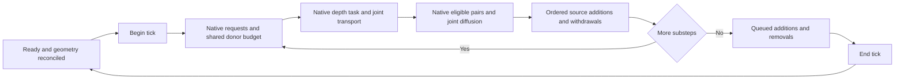

# Fluids API native adapter prototype

Implemented 2026-11-06 on top of the [transport prototype](fluids-transport-prototype.md). The adapter reads actual native water buffers, budgets native transfer requests before the depth task, coordinates composition across substeps, and publishes physical water quantities and badwater shares. Opt-in scheduler hooks are exercised against the actual native entry point inside an isolated host using Timberborn's installed Mono runtime. A flag-gated game-scene owner and disposable settlement fixture are implemented; production worker acceptance remains pending.

## Sources and boundaries

| Source | Responsibility |
| --- | --- |
| [NativeWaterArrayAdapter.cs](../src/FluidsApi/Native/NativeWaterArrayAdapter.cs) | Verify reflected native buffer fields and methods; capture padded column layouts; read and budget base/directed flow requests; publish depth and badwater |
| [NativeFluidTransportSession.cs](../src/FluidsApi/Native/NativeFluidTransportSession.cs) | Enforce stage order; own component volumes and ledgers; run joint transport/diffusion; apply physical sources, pumps, pressure limits, and geometry changes |
| [NativeTransportHooks.cs](../src/FluidsApi/GameBridge/NativeTransportHooks.cs) | Attach to one native starter, schedule dependent substep/change jobs, bind native sources and change queues, publish actual removal results, and remove owned patches |
| [FluidsApiSceneOwner.cs](../src/FluidsApi/Runtime/FluidsApiSceneOwner.cs) | Attach in native PostLoad and wait for native jobs before removing the scene's patches |
| [FluidWorkerAcceptance.cs](../src/FluidsApi/Runtime/FluidWorkerAcceptance.cs) | Flag-gated two-settlement fixture for real workers, geometry growth, pressure, native pump results and scene cleanup |
| [FluidColumnGeometry.cs](../src/FluidsApi/Transport/FluidColumnGeometry.cs) | Project wet intervals and pressure storage across splits, merges, solid displacement, and removed columns |
| [NativeAdapterScenarios.cs](../tools/compile-check/fluid-transport-harness/NativeAdapterScenarios.cs) | Native task, generated full-drain, pressure, ordering, geometry, and failure fixtures |
| [SourceRegressionScenarios.cs](../tools/compile-check/fluid-transport-harness/SourceRegressionScenarios.cs) | Deep Frontier source reproducer, native signed-source controls, generated withdrawals and blocked-emission accounting |
| [MonoProbe.cs](../tools/compile-check/fluid-native-mono/MonoProbe.cs) and [run_fluid_native_mono.py](../tools/run_fluid_native_mono.py) | Run reflected native access and the actual installed depth task under the game's Mono in a separate process |

The core adapter exposes arrays, primitive dimensions, immutable component values, and delegates in its experimental public contract. It has no compiled dependency on game or optional mod assemblies. A separate game bridge references the public native parallelizer interface and installed Harmony. Native field and method shapes are checked explicitly; a changed contract fails visibly. Reflection enumeration and invocation work under both .NET 8 and the installed Mono without adding unsafe access permissions to these prototype assemblies.

## Native operation order

The host supplies the native flow and depth callbacks and native diffusion eligibility. Each substep publishes the joint badwater share before sources run. Source operations are allowed only after that substep's transport. Queued changes are allowed only after all substeps finish. Geometry changes are reconciled between ticks. Unexpected layout changes during native callbacks and failed tasks fault the session visibly; callers cannot continue an incomplete tick.

The opt-in game bridge patches `WaterSimulationTaskStarter.ScheduleSimulationSteps` and `ScheduleUpdateWaterChanges` for one explicitly supplied starter. It uses the native dependency handles to schedule a substep job and a queued-change job. Actual native outflow, depth, and diffusion-eligibility tasks run within the substep, followed by provider-composed source emissions. The change job applies native queued additions/removals and fills the native `RemovedWater` dictionary with physical intake results. Closed queued targets apply zero, matching native `TryGetColumnIndex` behavior.

This correctness prototype executes each substep's row work serially inside its dependent job. Production row parallelism and performance are not established. The source/addition resolvers and initialization callback run in that job; they must use published data and avoid Unity calls from worker threads. The new scene-bound singleton attaches only with the explicit acceptance flag and a fresh-world token from its disposable loader. Without that flag, the prototype's configurators bind nothing.

The installed-Mono fixture calls actual native `Simulate` and exercises both patched scheduling methods through a deterministic immediate executor for the public native parallelizer interface. It verifies two ticks, source composition, queued physical pump results, per-tick result reset, duplicate-owner rejection, nonfinite source rejection, fault handling, and patch cleanup. This proves scheduling interception and operation order; it does not prove the production parallelizer's worker barriers.

Only one shared transport attachment may own the scheduler. A rejected second attachment cannot remove the first owner's patches when it is disposed. Detachment removes only this prototype's Harmony owner from its two target methods.

Since 2026-11-09 the hooks verify the whole native contract before they patch anything. `NativeSchedulerContract` checks every starter field, every `SimulationParameters` property, and each task constructor with the exact argument types the job passes. It also checks the value-type members the jobs read and the adapter's buffer members (`NativeWaterArrayAdapter.CheckContract`). A changed game produces one message listing every difference, before any patch exists; it no longer fails later on a worker thread. The Mono probe confirms that the installed types report nothing.

Attach also refuses any foreign Harmony owner on the two replaced scheduling methods, and on the native tasks the bridge skips instead of running (`UpdateContaminationTask.Run(int)`, `UpdateWaterSourcesTask.Run()`, `UpdateWaterChangesTask.Run()`). Those patches would silently stop running, so the error names every owner and method. This replaces the earlier lookup of Deep Frontier's `RadiationLockstep.Simulation` by name. Deep Frontier patches two of the skipped tasks from mod start, so the shared transport cannot attach while Deep Frontier is enabled, and the worker launcher disables it for the run.

## Physical volume and native badwater

The component vector is authoritative for physical stored volume. Native depth and overflow are a float representation of that state. The adapter publishes the vector's badwater share to the native `Contamination` field after transport, diffusion, source additions, pump removals, and geometry reconciliation. It replaces the independent contamination result at those boundaries.

Pressurized mixing uses `WaterDepth + Overflow` physical units. It does not treat `Overflow * OverflowPressureFactor` as additional material. Native source and queued-change concentration calculations therefore cannot be retained as a second authority. Unpressurized controls continue to agree with native behavior; pressure-weighted and invalid independent-share cases change deliberately.

The pressure fixture starts with 1.5 stored units, requests 2 from a source, and has capacity 2.875. It admits 1.375 units, records the rejected 0.625 units in the pressure-loss ledger, and retains 2.875. The existing 0.5 badwater units remain in the reservoir, giving a physical badwater share of about 0.17391. The legacy pressure-weighted control gives about 0.10417. A subsequent pump request for 0.75 non-bad plus 0.25 bad removes exactly one physical unit.

Hydraulic, geometry and queued-addition pressure-cap losses remain explicit physical operations on their resulting mixtures. Source admission instead limits the incoming mixture to available space before mixing: a blocked source cannot replace resident fluid. Rejected source emission is included in `Added` and `PressureLoss` for component accounting. Capacity retention is calculated directly from the retained amount. Subtracting `total - capacity` first can round to the entire total for a very large source and wrongly empty the reservoir; the regression includes a 1e30-unit request into a 2.875-unit capacity.

Native float representation differences are recorded and checked against a float-arithmetic bound. They are never written back into component volumes or treated as radioactive soil, fresh water, or an unexplained material sink. Component conservation and capacity comparisons retain their separate floating point error bounds.

## Deep Frontier source corrections integrated 2026-11-07

The original mod's build-291 fix exposed a missing native contract: `WaterSource.LimitStrength` permits negative strengths. The old aggregate radiation formula could retain all radioactive volume while a source reduced total water, turning a valid 100% radioactive column into 106.8215%. Deep Frontier now replays each native source operation in order and preserves the remaining clean cohort's fresh/radioactive ratio. Its regression also checks that a later pressure-blocked source does not dilute an earlier source.

The API now accepts finite negative strengths as source-stage withdrawals. `FluidTransportPrototype.RemoveSource` budgets the actual total withdrawal against physical water. Native source contamination selects bad versus non-bad withdrawal; if one cohort is exhausted, the remaining withdrawal draws from the other cohort, following native depth/contamination behavior. Every custom component retains its proportion within the remaining non-bad cohort. Complete drainage clears all components. `NativeFluidTransportSession.RemoveSource` publishes the result and records actual removed component volumes. This differs from a queued selective pump, which removes only its requested available cohorts.

The bridge preserves source and coordinate iteration order. Negative sources bypass `ResolveSource`, which describes emitted fluid, and never pass a negative addition into a provider. Zero-strength sources emit nothing. Nonfinite strengths, overflowed computed source volumes and invalid source contamination still fail explicitly and fault the scheduled tick.

Positive source admission now mixes only the volume that fits before the pressure cap. Previously the prototype mixed the entire request and then capped the combined mixture, allowing rejected fluid to recolor a full reservoir. This correction preserves resident components and attributes rejected amounts solely to the source emission. Each source sees the preceding source's resulting state.

The API already uses retained-volume arithmetic for near-empty pumps and joint conservative transport/diffusion for the earlier kernel share overflow. Those fixes remain in place. Deep Frontier's radiation-specific excess-to-soil rule is its content policy; the API prevents over-allocation in the shared transport producer and does not introduce a radiation gameplay dependency.

The .NET harness now passes **397,175 assertions in 31 scenarios**, including the 106.8215% negative control, native source parity, both overlapping orders, pressure rejection and 2,000 generated withdrawal cases with 4, 16 or 64 components. The installed-Mono scheduler probe passes **138 checks**, exercising the actual patched native entry point with signed sources and malformed inputs. Deep Frontier's compiled production regression independently passes **30,546 checks**. Real worker and save/reload acceptance remain pending.

The final source-fix static suite passes 75 checks plus the item-use report. Its Git-only guard cannot run without mirror Git metadata and passes separately in the real checkout. Logs: `source-fixes-full-validation.log`, `source-fixes-final-fluid.log`, `source-fixes-radiation.log` under `outputs/fluids-api-prototype/`.

## Flow request budgets

Raw native rates become accepted rates at the producer, before `WaterParametersUpdateTask` consumes them. In a stable native edge order, each request can use only its donor's remaining physical volume. If a limited rate rounds upward when converted to float, choose the immediately smaller representable float rate. The joint solver and native depth task then receive the same accepted rates.

Unfulfilled demand is recorded separately from material loss: that water did not move. No mixture shares are rescaled to repair an overdraw after transport. Native malformed rates, missing interior targets, and inconsistent buffer shapes still fail explicitly.

Two hundred generated full-drain fixtures exercise small donors with several outlets. They encounter about 1.98e-7 physical units of aggregate demand beyond the exact donor budgets. The largest observed native-float versus joint-volume difference is about 2.98e-8. These are correctness fixtures, not performance or production-map measurements.

## Geometry authority

For each changed cell, project the old column's wet vertical interval into the new open intervals. A solid block removes only the water in its occupied interval. A zero-thickness horizontal obstacle splits the mixture without deleting material. Merge every parent's component volumes, including pressure storage, before applying the new pressure capacity. New dry openings contain no invented water.

The harness exercises actual native `AddHorizontalObstacle`, `RemoveHorizontalObstacle`, `AddFullObstacle`, and `RemoveFullObstacle` queues and `WaterSimulator.ProcessModifications`. It initializes their `TickOnlyArray` buffers through the native load phase; it does not turn off access guards. The coordinator then reads the changed arrays and reconciles their mixtures. Other fixtures check raised floors, completely blocked cells, changed native indices, invalid overlapping openings, high-floor thin films, and 64-component capacity calculations.

Native `WaterSimulator.MergeColumns` adds parent `WaterDepth` values but retains only the lower parent's `Overflow`. A pressure fixture therefore has six physical units before merging and 5.5 immediately after the native merge. Shared geometry reconciliation preserves all six and republishes that physical volume. This is an explicit producing-rule change, with any actual new capacity loss reported separately.

Geometry reconciliation groups columns by map cell so it does not compare every old column with every new column across the whole map. The scheduling bridge captures current arrays at each substep and reconciles at the next ready tick boundary. The settlement fixture queues extra horizontal splits to exercise native buffer growth; this delivery path still needs the real-worker acceptance run.

## Scene integration and disposable worker acceptance

The `Game` configurator binds one owner, which locates the installed `WaterService`'s native starter during `PostLoad`. Its `Unload` calls the public parallelizer barrier before disposing owned Harmony patches. Native singleton unload order follows binding order, so the parallelizer may already have closed its workers; the owner still uses its public `Wait` barrier. Source inspection supports this order; two complete game-scene cycles must establish runtime behavior.

Since 2026-11-09 the owner also runs the public registry, defined in the [0.1 contract](fluids-api-contract.md). In `PostLoad` it freezes the process-wide registry, which happens once before the first world. It then activates a provider scene and loads provider state, which is empty in a fresh disposable world. Finally it attaches the transport sized to the registry. `Unload` waits at the barrier, disposes the hooks and unloads the provider scene. The main menu then checks that neither a transport owner nor a provider scene survived.

The fixture requires `-fluidsApiWorkerAcceptance -fluidsApiReport <absolute path>`. Its menu loader creates two new Iron Teeth settlements from the explicitly named 32 by 32 dry map. Only worlds started by that loader may activate the owner. The registry must hold exactly water, badwater, `FluidsApiSyntheticCompiled.Tracer` and `FluidsApiSyntheticReflection.Juice`, registered by the two fixture packages through the compiled and reflection routes. Test emissions are split evenly across every registered component, and conservation is checked for each one. It queues real obstacles, source emissions, additions and ten native non-bad intakes, checks physical accounting at native tick barriers, and returns to the menu between scenes. It records callback thread IDs and compares them with the scene's main thread. On success it disables its own prototype for the next launch, writes a JSON report and exits. This is not a save/reload test.

Use the configured PowerShell/Python executables and run from the real checkout:

1. Run `tools/create_fluid_acceptance_map.py` to create the dedicated local fixture. The source is the existing `Deep Frontier - All Buildings Test.timber` map; the generated map is ignored game data.
2. Run `tools/build_fluids_api.ps1 -SyntheticFixtures` with Timberborn and the Unity editor closed.
   - It stages `src/FluidsApi` and both fixtures, and invokes the official Mod Builder for those three mods, without bundles.
   - It verifies each installed manifest and every DLL hash against the official output, and rejects embedded dependencies.
   - It then moves the fixtures out of `Mods` into `outputs/fluids-api-prototype/fixture-packages`. Timberborn enables a newly installed mod by default, and the compiled fixture breaks mod start whenever Fluids API is disabled.
   - It does not rebuild or install Deep Frontier.
3. Run `tools/verify_fluids_api_package.ps1`. It re-checks the installed package and kept fixtures against `package-report.json`, then runs the installed-Mono probes against copies of the installed DLLs (API present) and of the fixture DLLs alone (API absent).
4. With Timberborn closed and Steam running, run `tools/start_fluid_worker_acceptance.ps1`.
   - It backs up the native PlayerData files and the Deep Frontier, API and fixture enablement keys.
   - It disables Deep Frontier, whose lockstep patches conflict with the shared transport, installs the two fixture packages for this run only, and starts the marked fixture.
   - After the owned process exits, including on failure or timeout, it removes the fixtures and any keys the game created for them, restores the original profile and verifies the file hashes.
   - No existing colony is loaded. Startup dialogs may still need clicking.

On 2026-11-09 the official Mod Builder rebuilt development version 0.0.1.0 with its four assemblies, including the new public `FluidsApi.dll`, and both fixtures.

- `outputs/fluids-api-prototype/package-report.json` records every DLL hash, each verified against the official build output, and the authored manifests matched byte for byte.
- `verify_fluids_api_package.ps1` passed. The installed assemblies pass all **1,159 installed-Mono checks** (`package-mono-report.json`). The kept fixture DLLs pass the absence probe (`package-absence-report.json`).
- Both probes use copies in ignored output folders and never change the installed package.

The installed prototype remains experimental. Flag-gated activation keeps ordinary settlements out of a system whose saver is not yet in the game. The package has no enablement key in the user's profile, which means it is enabled. Without the acceptance flag it binds nothing. The worker fixture compiles, but no `worker-report.json` result exists yet.

## Verification

As of 2026-11-09 the combined .NET 8 harness passes **402,478 assertions across 45 scenarios**. The 14 new scenarios cover the registry, providers, reflection binding, scene lifecycle, provider state, discovery, duplicate copies, optional consumers with the API present and absent, and save documents and round trips.

The isolated installed-Mono probe passes **1,159 checks**:

- actual native depth and scheduler execution, signed source order and pressure admission;
- source and change binding, physical pump-result delivery and owner cleanup;
- invalid-source fault handling, producer budgeting, type enumeration and reflection calls;
- the startup contract and foreign-patch refusal;
- byte-loaded consumers through both routes, the registry, provider state, and a bitwise save round trip;
- 1,000 exact quantity encodings, and detection of a second byte-loaded API copy.

A separate Mono process with no `FluidsApi.dll` passes the 5-check absence probe. All Release projects build with zero warnings or errors. Earlier counts: 397,175 assertions, 31 scenarios and 138 Mono checks on 2026-11-07.

Repository coverage includes the full suite with 80 passing checks and the item-use report, followed by the final static suite with 74 passing checks and the report. The fluid gate is rerun after the last fault-handling changes. The mirror's Git-only asset guard passes separately in the real checkout. Logs are `native-adapter-full-validation.log`, `native-hooks-final-validation.log`, and `native-adapter-acceptance.log` under `outputs/fluids-api-prototype/`.

After scene integration, the static suite again passes 74 checks plus the item-use report, with the same Git-metadata limitation covered in the real checkout. The final fluid gate passes after the padded-index fixture correction, including the fifth runtime project. Evidence: `lifecycle-full-validation.log`, `lifecycle-final-fluid-gate.log`, and the official-package reports described above. Real worker results remain separate and pending.

Run `tools/test_fluid_transport.ps1` in a freshly synchronized scratch mirror, or run the `fluid-transport` gate through `tools/validate_all.ps1`. Reports are `outputs/fluids-api-prototype/transport-report.json` and `mono-report.json`. The probe host reads machine paths from `tools/dev-environment.json` and runs in its own Python process. It does not load code into a running game or modify an installed mod or player save.

## Remaining work before a playable foundation

1. Run the two-settlement fixture, which now includes the registry and both consumer routes. It verifies real worker barriers, resized arrays, geometry delivery, removal-result consumption and scene teardown.
2. Bind the 0.1 registry ([contract](fluids-api-contract.md)) to source composition, intake conversion and native weather. Source composition and intake conversion are still prototype delegates.
3. Add the game-side saver and loader for `FluidSaveDocument`, with an in-game save/reload fixture, then the Deep Frontier importer and migration. Component identity, the bit-exact round trip and geometry projection are already proven in the harness and in Mono.
4. Measure active-area work and memory on real maps, then finish shared rendering. The current reflected full-buffer prototype has no production performance acceptance yet.
